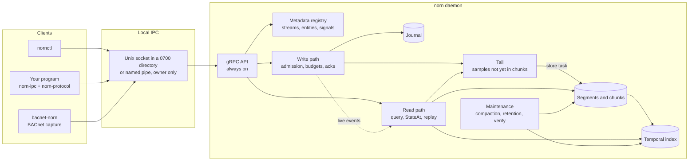
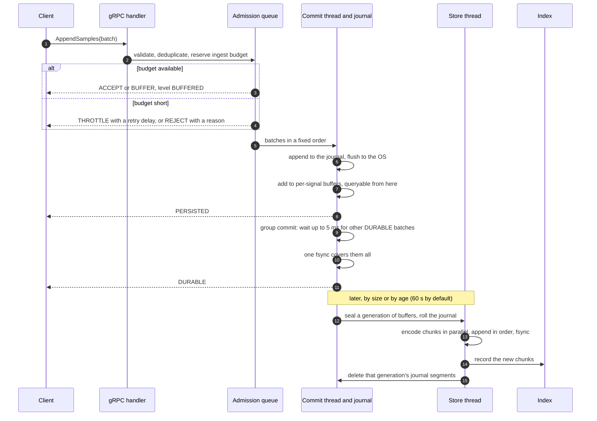
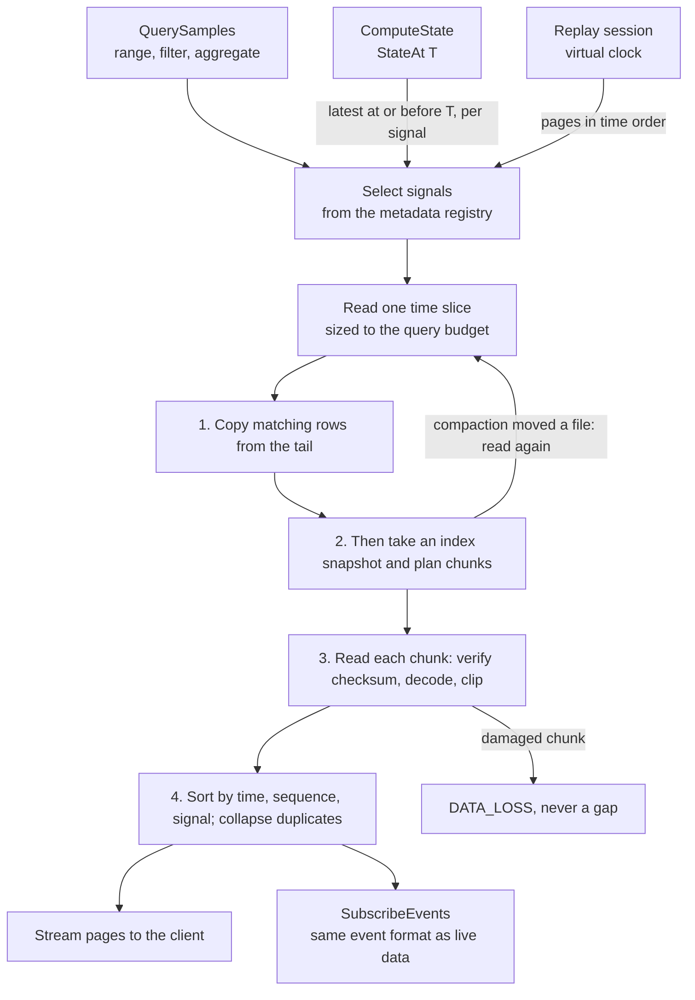
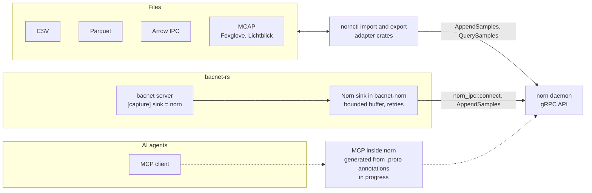
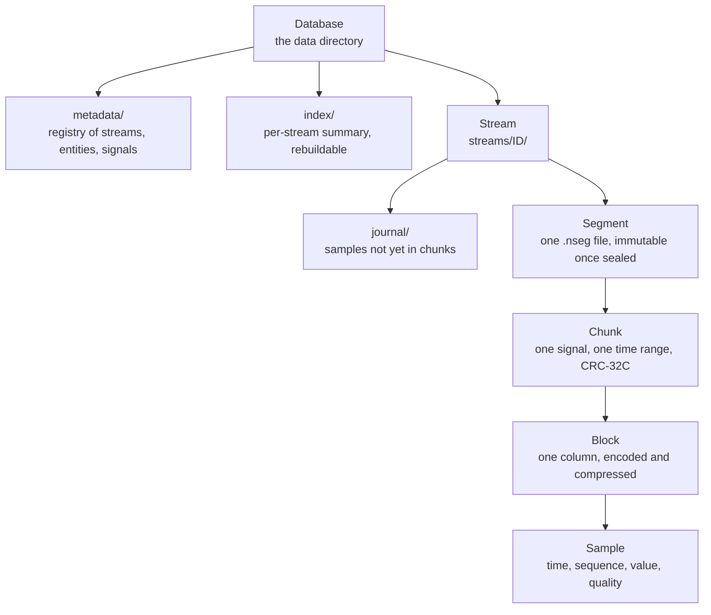

<div align="center">

<h1>Norn</h1>

<p><strong>A pure-Rust, domain-independent temporal data engine.</strong><br>
It stores the history of systems, answers questions about any instant of it, and replays it.</p>

<p>
<a href="https://github.com/oh-tarnished/norn/actions/workflows/ci.yml"></a>
<a href="https://github.com/oh-tarnished/norn/releases"></a>
<a href="https://github.com/oh-tarnished/norn/commits/main"></a>
<a href="LICENSE"></a>
<a href="#installation"></a>
</p>

<p>
<a href="rust-toolchain.toml"></a>
<a href="https://tokio.rs"></a>
<a href="https://github.com/hyperium/tonic"></a>
<a href="https://grpc.io"></a>
<a href="protobuf"></a>
<a href="buf.yaml"></a>
</p>

<p>
<a href="https://parquet.apache.org"></a>
<a href="https://arrow.apache.org"></a>
<a href="https://mcap.dev"></a>
<a href="docs/reference/storage.md"></a>
<a href="https://modelcontextprotocol.io"></a>
</p>

</div>

Norn is a local daemon. Programs send it timestamped samples over gRPC on a Unix
socket or a Windows named pipe. It journals them, compresses them losslessly into
checksummed chunks, indexes them by time, and answers range queries, aggregates, the
state of every signal at an instant, and deterministic replays. It knows entities,
signals and streams, and never what they mean.

**Status.** Version 0.1.0 is built and not yet released: no tag and no published
archive exist. Everything marked Done below runs today and is covered by tests. The
CI badge shows the current state of `main`. The [roadmap](#roadmap) lists what is left
before the release and what comes after it.

## Contents

**This page**

1. [What it is and why](#what-it-is-and-why)
2. [Features](#features)
3. [Architecture](#architecture): [system](#the-whole-system),
   [servers](#servers-always-on-and-optional), [write path](#the-write-path),
   [read path](#the-read-path), [integrations](#adapters-mcp-and-bacnet-rs),
   [storage](#storage-hierarchy)
4. [Installation](#installation)
5. [Quick start](#quick-start)
6. [Configuration](#configuration)
7. [Using Norn from your own code](#using-norn-from-your-own-code)
8. [Connecting to bacnet-rs](#connecting-to-bacnet-rs)
9. [Operations](#operations)
10. [Performance](#performance)
11. [Roadmap](#roadmap)
12. [Contributing](#contributing), [Security](#security), [Licence](#licence)

**Guides**

| Guide                                             | What it covers                                       |
| ------------------------------------------------- | ---------------------------------------------------- |
| [Getting started](docs/guides/getting-started.md) | build, run, create, append, list                     |
| [Configuration](docs/guides/configuration.md)     | every key and its default                            |
| [Ingesting data](docs/guides/ingesting-data.md)   | batches, acknowledgements, backpressure              |
| [Querying](docs/guides/querying.md)               | ranges, filters, aggregates, resuming                |
| [Replay and state](docs/guides/replay.md)         | state at an instant, replay, live subscriptions      |
| [Import and export](docs/guides/import-export.md) | CSV, Parquet, Arrow, MCAP, both ways                 |
| [Operations](docs/guides/operations.md)           | stopping, data directory, recovery, damage           |
| [Troubleshooting](docs/guides/troubleshooting.md) | real errors and what they mean                       |
| [AI agents](docs/guides/ai-agents.md)             | `norn-mcp`, which is being replaced: see [MCP](#mcp) |

**Reference**

| Reference                                      | What it covers                                      |
| ---------------------------------------------- | --------------------------------------------------- |
| [Architecture](docs/reference/architecture.md) | layers, dependency table, process model             |
| [Protocol](docs/reference/protocol.md)         | the gRPC API, errors, versioning                    |
| [Storage](docs/reference/storage.md)           | file format, write path, recovery, index, codecs    |
| [IPC](docs/reference/ipc.md)                   | transports, endpoints, security model               |
| [Query](docs/reference/query.md)               | read path, StateAt, exact semantics, bounds         |
| [Replay](docs/reference/replay.md)             | virtual clock, sessions, subscriptions, bounds      |
| [Adapters](docs/reference/adapters.md)         | the contract, CSV, Parquet, Arrow, MCAP formats     |
| [nornctl](docs/reference/cli.md)               | every command                                       |
| [MCP](docs/reference/mcp.md)                   | `norn-mcp`'s tools; being replaced: see [MCP](#mcp) |

**Project**

| Document                              | What it covers                        |
| ------------------------------------- | ------------------------------------- |
| [Performance](docs/performance.md)    | every measurement and how it was made |
| [Specification](docs/project/spec.md) | the binding brief                     |
| [Plan](docs/project/plan.md)          | how the work is split, and its status |

**Images**, captured from a real daemon by
[`tools/screenshots/capture.sh`](tools/screenshots/capture.sh):
[status](docs/images/nornctl-status.svg),
[version](docs/images/nornctl-version.svg),
[signals](docs/images/nornctl-signals.svg),
[append](docs/images/nornctl-append.svg),
[query](docs/images/nornctl-query.svg),
[streams](docs/images/nornctl-streams.svg).

## What it is and why

Many systems need the same thing from their telemetry: keep years of it on one
machine, lose nothing that was acknowledged, and answer "what did the system look
like at 08:00:15, and what happened around it?" quickly. Norn does that one job, for
any domain.

- **One process, local.** A daemon owns a data directory. Clients reach it only
  through local IPC. There is no network listener and no external database.
- **Domain-independent.** The core knows entities, signals, streams, samples, values,
  timestamps, sequences and quality. Building telemetry over BACnet is the first
  workload, but no BACnet term appears in the engine. Domain facts travel as opaque
  annotations.
- **Time first.** Storage, indexing, queries, state at an instant and replay are all
  organised around time.
- **Pure Rust.** No C in any shipped dependency graph (`xtask deps` enforces it), and
  no `protoc` needed to build. `unsafe` is denied workspace-wide, with one audited
  exception: the owner-only security descriptor for Windows named pipes.
- **Bounded.** Every memory budget and count limit is configured and enforced. When a
  budget runs out, clients are slowed or refused, and nothing is dropped silently.

## Features

| Feature                                                        | State       | Notes                                                             |
| -------------------------------------------------------------- | ----------- | ----------------------------------------------------------------- |
| Append over gRPC, with backpressure and acknowledgement levels | Done        | `ACCEPT`, `BUFFER`, `THROTTLE`, `REJECT`; `BUFFERED` to `DURABLE` |
| Journal, group commit, fsync                                   | Done        | `DURABLE` only after `fsync` returns                              |
| Compressed, checksummed chunks in segment files                | Done        | delta-of-delta, Gorilla, ALP, dictionaries, zstd levels 3 to 6    |
| Sparse temporal index                                          | Done        | rebuilt from the segments if lost                                 |
| Range queries, filters, aggregates, resume tokens              | Done        | sees samples as soon as they are acknowledged                     |
| State at an instant (`StateAt`)                                | Done        | from the index; checkpoints measured and not needed               |
| Deterministic replay and live subscriptions                    | Done        | virtual clock: pause, seek, step, speed                           |
| Crash recovery                                                 | Done        | tested by killing the process, not by cutting power               |
| Compaction, retention, verification                            | Done        | in the background and on demand                                   |
| Import and export: CSV, Parquet, Arrow IPC, MCAP               | Done        | through `nornctl`, over the public API                            |
| `nornctl` command-line client                                  | Done        | no `inspect`, `stats` or `benchmark` yet                          |
| MCP for AI agents, built into the daemon                       | In progress | see [MCP](#mcp)                                                   |
| BACnet capture through bacnet-rs                               | In progress | built and tested in bacnet-rs, awaiting review there              |
| Shared-memory data plane                                       | Planned     | measured, and not faster than gRPC at the target rates            |
| Fuzzing, security review                                       | Planned     | stage 16                                                          |
| Modbus, OPC-UA and MQTT adapters                               | Planned     |                                                                   |
| Metrics export, backup tooling, encryption at rest             | Not built   |                                                                   |

## Architecture

### The whole system



The daemon is one process. Its runtime owns the IPC server, the health mirror and the
maintenance worker. `Runtime::new` spawns nothing; `run` owns every task and returns
only when all have stopped. Details: [architecture](docs/reference/architecture.md).

### Servers: always on and optional

| Server              | On or off                         | Why                                                                                                                              |
| ------------------- | --------------------------------- | -------------------------------------------------------------------------------------------------------------------------------- |
| gRPC                | Always on. It cannot be disabled. | It is the only API. `nornctl`, the adapters and every client use it; nothing reaches storage another way.                        |
| MCP                 | Optional: off or on               | In progress: moving into `norn`, switched by configuration. Today it is a separate program, `norn-mcp`, which is being replaced. |
| Shared-memory plane | Not in v0.1                       | Built and measured on a branch; it does not beat gRPC at the target rates.                                                       |
| InfluxDB            | Not used                          | Norn has no InfluxDB dependency. In bacnet-rs, InfluxDB capture is opt-in and off by default.                                    |

### The write path



Each batch hears two answers: its admission, then the level it asked for. A failed
`fsync` poisons the journal writer, every waiting batch gets an error, and the next
start runs recovery. Details: [ingesting data](docs/guides/ingesting-data.md),
[storage](docs/reference/storage.md).

### The read path



Reading the tail before taking the index snapshot means a sample acknowledged at
`PERSISTED` is always in one or the other, so a query sees it exactly once. Details:
[query](docs/reference/query.md), [replay](docs/reference/replay.md).

### Adapters, MCP and bacnet-rs



Every adapter is a client of the public gRPC API and nothing else. Formats:
[adapters](docs/reference/adapters.md).

### Storage hierarchy



A segment is append-only while open and immutable once sealed. A chunk is encoded,
compressed and checksummed independently of every other chunk, so damage is found
and reported per chunk. File formats: [storage](docs/reference/storage.md).

## Installation

### Prerequisites

| Need                  | Version               | Notes                                                                |
| --------------------- | --------------------- | -------------------------------------------------------------------- |
| Rust                  | 1.99.1                | pinned in `rust-toolchain.toml`; `rustup` installs it on first build |
| C toolchain, `protoc` | none                  | the generated protocol code is committed                             |
| Operating system      | Linux, macOS, Windows | Linux release builds need glibc 2.35 or newer                        |
| `just`                | any recent            | optional; runs the same commands CI runs                             |

Working on Norn itself also needs Buf 1.75.0, cargo-deny 0.20.2 and Go for the AIP
linter: see [CONTRIBUTING.md](CONTRIBUTING.md).

### Build from source

```sh
git clone https://github.com/oh-tarnished/norn.git
cd norn
cargo build --release --locked -p norn-server -p norn-cli
```

This builds `target/release/norn`, the daemon, and `target/release/nornctl`, the
command-line client. Put that directory on your `PATH` for the commands below.

### Release archives

No release has been published yet. When `v0.1.0` is tagged, the
[release workflow](.github/workflows/release.yml) builds one archive per target and
publishes each with a `.sha256` file to check it against:

| Target                      | Built on         |
| --------------------------- | ---------------- |
| `x86_64-unknown-linux-gnu`  | Ubuntu 22.04     |
| `aarch64-unknown-linux-gnu` | Ubuntu 22.04 ARM |
| `aarch64-apple-darwin`      | macOS 15         |
| `x86_64-apple-darwin`       | macOS 15 Intel   |
| `x86_64-pc-windows-msvc`    | Windows          |

Each archive carries the binaries (`.exe` on Windows), this README, the documentation
and the licences.

## Quick start

Everything below was run against a fresh daemon built from commit 93a979c on macOS,
and the output is copied as printed. Use two terminals.

**1. Start the daemon.** It runs in the foreground and logs to stderr. With no flags it
uses the per-user endpoint and data directory. (This run set `TMPDIR=/tmp/norn-demo/t`,
which is where the default endpoint lives.)

```console
$ norn
2026-11-02T17:40:13.695789Z  INFO registry open records=0 torn=0
2026-11-02T17:40:13.705887Z  INFO listening endpoint=unix:/tmp/norn-demo/t/norn/norn.sock version="0.1.0"
2026-11-02T17:40:13.706435Z  INFO runtime serving tasks=5
```

One long `recovery finished` line is left out between the first two.

**2. Check the connection.** `version` negotiates the protocol.

```console
$ nornctl version
client: nornctl/0.1.0
client_protocol: 1.4
server_version: 0.1.0
agreed_protocol: 1.4
```

**3. Create a stream, an entity and two signals.** A stream is a sequence of
observations, an entity is a thing, and a signal is something measurable about it,
with one value type.

```console
$ nornctl streams create plant
streams/plant
$ nornctl entities create ahu-01
entities/ahu-01
$ nornctl signals create ahu-01 supply-temp plant double
entities/ahu-01/signals/supply-temp
$ nornctl signals create ahu-01 fan-speed plant double
entities/ahu-01/signals/fan-speed
```

**4. Append.** Each call prints its admission, then the level reached. The default
level is `DURABLE`. `--at` sets the observation time.

```console
$ nornctl append plant entities/ahu-01/signals/supply-temp 21.0 --at 2026-11-02T08:00:00Z --sequence 1
BACKPRESSURE_OUTCOME_ACCEPT ACKNOWLEDGEMENT_LEVEL_BUFFERED
BACKPRESSURE_OUTCOME_ACCEPT ACKNOWLEDGEMENT_LEVEL_DURABLE
```

Five more were appended the same way: `fan-speed` 40 at 08:00:00, `supply-temp` 21.4
at 08:00:10, `fan-speed` 55 at 08:00:20, and `supply-temp` 21.9 at 08:00:30, sent
twice with the same sequence number.

**5. Query.** The resend is stored once.

```console
$ nornctl query ahu-01 --order time
2026-11-02T08:00:00Z entities/ahu-01/signals/supply-temp 21 GOOD seq=1
2026-11-02T08:00:00Z entities/ahu-01/signals/fan-speed 40 GOOD seq=2
2026-11-02T08:00:10Z entities/ahu-01/signals/supply-temp 21.4 GOOD seq=3
2026-11-02T08:00:20Z entities/ahu-01/signals/fan-speed 55 GOOD seq=4
2026-11-02T08:00:30Z entities/ahu-01/signals/supply-temp 21.9 GOOD seq=5
$ nornctl query ahu-01 --agg max --window 30s --from 2026-11-02T08:00:00Z --to 2026-11-02T08:01:00Z
2026-11-02T08:00:00Z 2026-11-02T08:00:30Z entities/ahu-01/signals/fan-speed 55 count=2
2026-11-02T08:00:00Z 2026-11-02T08:00:30Z entities/ahu-01/signals/supply-temp 21.4 count=2
2026-11-02T08:00:30Z 2026-11-02T08:01:00Z entities/ahu-01/signals/supply-temp 21.9 count=1
```

**6. State at an instant.** What every signal held at 08:00:15.

```console
$ nornctl state ahu-01 --at 2026-11-02T08:00:15Z
state_time: 2026-11-02T08:00:15Z
2026-11-02T08:00:00Z entities/ahu-01/signals/fan-speed 40 GOOD seq=2
2026-11-02T08:00:10Z entities/ahu-01/signals/supply-temp 21.4 GOOD seq=3
```

**7. Replay.** A session starts paused; subscribing with `--resume` starts its clock.
`--speed max` plays as fast as the subscriber reads.

```console
$ nornctl replay create ahu-01 --from 2026-11-02T08:00:00Z --to 2026-11-02T08:01:00Z --speed max --id morning
replaySessions/morning PAUSED at=2026-11-02T08:00:00Z emitted=0 pace=max from=2026-11-02T08:00:00Z to=2026-11-02T08:01:00Z
$ nornctl subscribe replay morning --resume
#1 2026-11-02T08:00:00Z RUNNING
#2 2026-11-02T08:00:00Z 2026-11-02T08:00:00Z entities/ahu-01/signals/supply-temp 21 GOOD seq=1
#3 2026-11-02T08:00:00Z 2026-11-02T08:00:00Z entities/ahu-01/signals/fan-speed 40 GOOD seq=2
#4 2026-11-02T08:00:10Z 2026-11-02T08:00:10Z entities/ahu-01/signals/supply-temp 21.4 GOOD seq=3
#5 2026-11-02T08:00:20Z 2026-11-02T08:00:20Z entities/ahu-01/signals/fan-speed 55 GOOD seq=4
#6 2026-11-02T08:00:30Z 2026-11-02T08:00:30Z entities/ahu-01/signals/supply-temp 21.9 GOOD seq=5
#7 2026-11-02T08:01:00Z ENDED
```

**8. Where the samples are.** They are safe in the journal and still buffered: no
chunk has been written yet, so `verify` has nothing to read.

```console
$ nornctl streams
streams/plant samples=5 buffered=5
$ nornctl verify plant
streams/plant segments=0 chunks=0 samples=0 bytes=0 damaged_chunks=0 damaged_samples=0
```

A clean stop (Ctrl-C) stores the buffers as chunks. After restarting `norn`, one more
append at 08:00:40, and another stop and start, the stream holds two segments:

```console
$ nornctl verify plant
streams/plant segments=2 chunks=3 samples=6 bytes=633 damaged_chunks=0 damaged_samples=0
```

**9. Compact, then verify.** Compaction merges neighbouring segments and re-encodes
each signal's chunks. `verify` then reads and checks every chunk again.

```console
$ nornctl compact plant
streams/plant chunks=3->2 bytes=633->408 skipped_segments=0
$ nornctl verify plant
streams/plant segments=1 chunks=2 samples=6 bytes=408 damaged_chunks=0 damaged_samples=0
```

**10. Export.** An export never overwrites a file.

```console
$ nornctl export ahu-01 --format parquet --output ahu-01.parquet
exported samples=6 signals=2 bytes=4452 to ahu-01.parquet
$ nornctl export ahu-01 --format csv --output ahu-01.csv
exported samples=6 signals=2 bytes=989 to ahu-01.csv
```

The file carries the catalogue too, so importing it into an empty daemon recreates the
stream, the entity and the signals:

```console
$ nornctl import ahu-01.parquet --ack persisted
imported read=6 sent=6 present=0 duplicate=0 created=4 batches=1 throttled=0 retried=0
$ nornctl query ahu-01 --agg count
- - entities/ahu-01/signals/fan-speed 2 count=2
- - entities/ahu-01/signals/supply-temp 4 count=4
```

**11. Shut down.** Ctrl-C or SIGTERM. In-flight calls drain and the exit status is 0.

```text
INFO shutdown requested signal="SIGTERM"
INFO runtime draining tasks=5
INFO ipc drained aborted=0
INFO runtime stopped aborted=0
INFO stopped aborted=0
```

Each step has a guide with more: [getting started](docs/guides/getting-started.md),
[querying](docs/guides/querying.md), [replay and state](docs/guides/replay.md),
[import and export](docs/guides/import-export.md).

## Configuration

```text
norn [--config PATH] [--listen ENDPOINT] [--data-dir PATH] [--log-level LEVEL] [--log-format FORMAT]
```

Each setting comes from the first of: a flag, the TOML file named by `--config`, the
default. Without `--config` no file is read. An unknown key is refused, so a typo
cannot leave a limit at its default. The settings that matter most:

| Key                                    | Default                             | Meaning                                                           |
| -------------------------------------- | ----------------------------------- | ----------------------------------------------------------------- |
| `listen`                               | the per-user endpoint               | `unix:PATH`, a Windows `pipe:` name, or loopback `tcp:` for tests |
| `data_dir`                             | `$XDG_DATA_HOME/norn` or equivalent | where the metadata, streams and index live                        |
| `drain_timeout_ms`                     | 10000                               | how long in-flight calls get on shutdown                          |
| `[memory] total_bytes`                 | 536870912 (512 MiB)                 | the sum of every subsystem budget                                 |
| `[limits] max_batch_samples`           | 10000                               | samples in one append batch                                       |
| `[limits] max_pending_batches`         | 256                                 | batches in flight                                                 |
| `[storage] group_commit_interval_ms`   | 5                                   | the longest a `DURABLE` batch waits to share an fsync             |
| `[storage] max_chunk_age_ms`           | 60000                               | the longest a sample waits to be encoded into a chunk             |
| `[storage] durable_acks`               | true                                | false: no fsync, and `DURABLE` is refused, not weakened           |
| `[maintenance] compaction_interval_ms` | 300000                              | how often compaction looks for work                               |
| `[maintenance] retention_interval_ms`  | 3600000                             | how often retention policies are applied                          |
| `[log] format`                         | `text`                              | `text`, or `json` for one object per line                         |

These defaults were picked, not measured; stage 15 revisits them. Every key, with a
complete file: [configuration](docs/guides/configuration.md).

## Using Norn from your own code

### gRPC

The Protobuf schema under [`protobuf/`](protobuf) is the API and its source of truth.
Services: `StreamService`, `EntityService`, `SignalService`, `TelemetryService`
(`AppendSamples`, `SubscribeEvents`), `QueryService`, `StateService`, `ReplayService`
and `AdminService`, plus the standard `grpc.health.v1`. Clients negotiate a protocol
version, currently 1.4.

A Rust client needs `norn-ipc` to dial the local endpoint and `norn-protocol` for the
generated stubs. [`crates/cli/examples/plain_client.rs`](crates/cli/examples/plain_client.rs)
is a complete client with nothing of the daemon in it: it creates a stream, an entity
and a signal, and appends through a bounded channel.

```console
$ cargo run -p norn-cli --example plain_client -- unix:/tmp/norn-demo/t/norn/norn.sock
batch 1 reached ACKNOWLEDGEMENT_LEVEL_BUFFERED
batch 1 reached ACKNOWLEDGEMENT_LEVEL_DURABLE
```

Any gRPC tool that speaks HTTP/2 over a Unix socket works too. The daemon offers no
server reflection, so give the tool a descriptor set built by `buf`:

```console
$ buf build -o norn.binpb
$ grpcurl -plaintext -unix -authority localhost -protoset norn.binpb \
    -d '{"name":"server"}' /tmp/norn-demo/t/norn/norn.sock norn.admin.v1.AdminService/GetServer
{
  "name": "server",
  "serverVersion": "0.1.0",
  "protocolVersion": {
    "major": 1,
    "minor": 4
  },
```

(The response continues with capabilities, limits and recovery counters.) The
semantics of every method, error and acknowledgement level:
[protocol](docs/reference/protocol.md). Endpoints and the security model:
[IPC](docs/reference/ipc.md).

### nornctl

`nornctl` uses only the public API; it has no private door. Exit status is 0 on
success, 1 when a command failed and 2 for a command line it could not parse, so it
scripts cleanly. Every command, with real output: [nornctl](docs/reference/cli.md).

### MCP

In progress. MCP is moving into the daemon. Its tools are generated by `protoc-gen-mcp`
from `(mcp.v1.tool)` annotations on the RPCs in the `.proto` files, and served by
`norn` itself through runtime-rs's `HybridServer`, turned off or on by configuration.
Each tool is a gRPC method first, so MCP can do nothing the API cannot. That work has
started and is not finished; this section will describe it once it lands.

Until then the tree still builds `norn-mcp`, a separate read-only program with ten
tools, documented in [AI agents](docs/guides/ai-agents.md) and [MCP](docs/reference/mcp.md).
It is being replaced, so do not build on it.

## Connecting to bacnet-rs

bacnet-rs records BACnet readings into Norn as a client over local IPC, and in this
mode stores nothing itself. BACnet knowledge stays in bacnet-rs: devices become
entities, properties become signals, and BACnet details become `bacnet.*` annotations
that Norn stores and never interprets.

**State.** The sink is built and verified end to end against a real `norn` (start,
`kill -9`, restart, then every acknowledged reading read back with `nornctl state` and
`nornctl replay`). It is awaiting review in bacnet-rs and is not merged there yet.

Capture is configuration in bacnet-rs's `server.toml`, not a flag:

```toml
[capture]
sink = "norn"                          # or "files", the Parquet capture
endpoint = "unix:/run/norn/norn.sock"  # default: Norn's per-user endpoint
stream = "regalium"                    # created if missing
ack = "persisted"                      # received, buffered, persisted, durable
buffer = 1000000                       # readings held while Norn is away or behind
site = "tower-a"
```

The sink lives in its own binary, `bacnet-norn`, because it links Norn's AGPL client
crates (`norn-ipc`, `norn-transport`), and bacnet-rs keeps those out of its main
workspace. The ordinary `bacnet` binary reads the same section and refuses
`sink = "norn"` by naming `bacnet-norn`. In a bacnet-rs checkout:

```sh
cargo build --release --manifest-path tools/bacnet-norn/Cargo.toml
bacnet-norn server --config server.toml
```

How the sink behaves:

- One `AppendSamples` call is held open, with up to 16 batches in flight, cut to the
  limits the daemon publishes.
- `THROTTLE` and transient `REJECT` are retried. A lost daemon is reconnected with
  backoff and everything unacknowledged is resent; sequence numbers make a resend a
  counted duplicate, not a second copy.
- Readings wait in a bounded buffer while Norn is away. Past it, the oldest are
  dropped, and that loss is counted, logged and written into Norn as an event.
- Norn going away is reported through the BACnet server's health and logs; the server
  keeps serving.

bacnet-rs pins Norn by git revision (`2aa2394`, protocol 1.3) and will move to the
v0.1.0 tag once it exists. Norn itself has no InfluxDB dependency. In bacnet-rs,
InfluxDB capture is an opt-in part of the `files` sink, behind a Cargo feature that is
off by default.

## Operations

Output below is real, from a daemon built from the same commit as the quick start.

**Recovery** runs at every start; nothing needs doing. After a clean stop, each
stream's `CLEAN` marker vouches for its sealed segments, so a start reads no chunk.
After a crash, everything the marker does not vouch for is read and checked, and the
journal is replayed. Here one `DURABLE` sample was acknowledged and the daemon got
`kill -9`:

```console
$ nornctl append plant entities/ahu-01/signals/supply-temp 22.2 --at 2026-11-02T08:00:50Z --sequence 7
BACKPRESSURE_OUTCOME_ACCEPT ACKNOWLEDGEMENT_LEVEL_BUFFERED
BACKPRESSURE_OUTCOME_ACCEPT ACKNOWLEDGEMENT_LEVEL_DURABLE
$ kill -9 "$daemon"; norn &
$ nornctl status | grep -E 'recovery\.(streams|events|corruptions|replayed)'
recovery.streams: 1
recovery.events: 1
recovery.corruptions: 0
recovery.replayed_samples: 1
$ nornctl streams
streams/plant samples=7
```

**Verification.** `nornctl verify STREAM` reads every chunk of every sealed segment,
changes nothing, and exits 1 on damage. A start does not look for bit rot in segments
the marker vouches for, so schedule `verify`. Damage is reported and never repaired: a
query reaching a damaged chunk fails with `DATA_LOSS` rather than skipping it.

**Compaction** runs every 5 minutes by default, and on demand with `nornctl compact`.
Queries, `StateAt`, replay and ingest carry on throughout, and no sample is lost or
doubled; a test kills a real daemon at every phase of a compaction to check that.

**Retention.** A stream keeps everything until a policy is set. Age is measured from
the stream's newest sample, not the wall clock. Setting a policy authorises deletion,
so try `--dry-run` first:

```console
$ nornctl retention set plant 14d
streams/plant max_age=1209600s
$ nornctl retention apply plant --dry-run
streams/plant would remove segments=0 samples=0 bytes=0 retained_bytes=408 cutoff=2026-10-19T08:00:40Z
```

Only whole segments go, the newest always stays, and every removal is logged at
`WARN`. The full guide, with damage handling and the data directory:
[operations](docs/guides/operations.md).

## Performance

All figures are from one Apple M3 Max with a local SSD, release builds, client and
daemon on one machine, over gRPC on a Unix socket. Nothing has been measured on Linux
or Windows yet. Full tables and methods: [performance](docs/performance.md).

| What                               | Result                   | How it was measured                                                                                         |
| ---------------------------------- | ------------------------ | ----------------------------------------------------------------------------------------------------------- |
| Sustained append, `DURABLE`        | 16,044 samples/s         | `cargo bench -p norn-server --bench append`: 30 s, 16,000 signals, one call; p50 18.11 ms, p99 29.26 ms     |
| Burst append, `DURABLE`            | 120,010 samples/s        | same, 15 s; p50 16.34 ms, p99 22.68 ms. The offered rate was met, so this is not a maximum                  |
| Peak daemon RSS                    | 110 MiB of 512 MiB       | across the four write-path runs, a 21% share of the default budget                                          |
| Startup, 115 M samples             | 88 to 94 ms              | spawn to first answer after a clean stop, warm page cache; 2.6 s without the marker, 1.19 s after `kill -9` |
| Storage, compacted                 | 1.200 bytes/sample       | 57.6 million samples: one hour of 16,000 signals at 1 Hz, in an assumed mix of signal shapes                |
| Storage, before compaction         | 2.195 bytes/sample       | the same hour                                                                                               |
| A year, compacted                  | about 0.61 TB            | **extrapolated** linearly from that one hour, not a measured year; a noisy site could reach 3.45 TB         |
| Index startup, compacted year      | 32.0 ms                  | 16,000 signals, 8,760 segments, 140.2 million chunks; real index files, chunk bodies left out               |
| Index lookup, one signal, one hour | p50 49.5 µs, p99 6.53 ms | same dataset, empty index cache, single-threaded; locates chunks without reading them                       |
| gRPC round trip                    | p50 31 µs, p99 45–50 µs  | unary health check, 20,000 calls, two runs                                                                  |
| Query, one signal, one hour        | p50 1.41 ms, p99 2.29 ms | 3,600 raw samples; 200 signals at 1 Hz for one day, a scaled-down set                                       |
| Query, one signal, one day         | p50 6.31 ms, p99 6.69 ms | AVERAGE per minute over 86,400 samples; same set                                                            |
| Query, all signals, latest         | p50 7.22 ms, p99 8.12 ms | LATEST of 200 signals; same set. Not measured at 16,000                                                     |
| StateAt, all signals               | p50 83.0 ms, p99 349 ms  | 16,000 signals, random instants, all pages; 15 minutes of data, scaled down                                 |
| StateAt, one signal                | p50 453 µs, p99 791 µs   | same set                                                                                                    |
| Replay, maximum speed              | 1.15 M samples/s         | 14.4 million samples to one subscriber, three runs                                                          |
| Export, Parquet                    | 2.17 M samples/s         | `nornctl export`, 1 million samples, median of three; 1.66 bytes/sample                                     |
| Import, Parquet                    | 365 k samples/s          | `nornctl import` into a fresh daemon at `PERSISTED`, same data, median of three                             |

Caveats:

- **Year figures are extrapolated** from short runs with an assumed signal mix.
  Measure a real site before sizing disks.
- **Crash tests cover process death** (`kill -9`), not power loss. `DURABLE` is
  designed to survive power loss, but no test has cut the power.
- Performance is measured on macOS only. Linux and Windows are tested in CI, not
  measured.
- Several results use scaled-down datasets, as noted. The specification's full matrix
  (1,000 to 100,000 signals, 1 to 100 Hz) has not been run.

## Roadmap

### v0.1

Version 0.1.0 is everything marked Done in [Features](#features): ingest with
backpressure and durable acknowledgements, compressed and checksummed storage, the
temporal index, queries, `StateAt`, replay and live subscriptions, crash recovery,
compaction, retention and verification, import and export in four formats, and
`nornctl`. The licence is settled.

Release steps left:

1. CI green on Linux, macOS and Windows at one commit. At the time of writing, the
   Windows test job fails on `main`.
2. Decide whether v0.1.0 waits for MCP inside the daemon. The release recipe still
   packages `norn-mcp` today.
3. Tag `v0.1.0`. The release workflow checks the tag against the workspace version,
   runs the gates, builds the five targets and publishes the archives with checksums.

### Next

Use the release against BACnet on a real recording flow: `bacnet-norn` with
`[capture] sink = "norn"` recording a building into a v0.1.0 daemon, then reading it
back with queries, `StateAt` and replay.

### Discussed, not committed

- **Shared memory (iceoryx2).** A data plane on iceoryx2 was built and measured on a
  separate branch. It does not beat gRPC at the target rates: every plane met 16,000
  and 120,000 samples/s; `DURABLE` latency is about 20 ms on every plane, which is
  group commit and fsync; and the `BUFFERED` gain is about 0.25 ms. It wins only on
  `DURABLE` peak throughput, which no target needs yet. It stays out of v0.1.
- **GPU pattern detection with GGML.** A separate, optional program that reads through
  the public API, runs detector algorithms and writes its findings back as signals,
  with a CPU path when there is no GPU. GGML is C, so it would be a narrow, accepted
  exception: never in the core, the engine or the default build. Which patterns to
  detect is not decided.

### Later

- Fuzzing and a security review.
- The full benchmark matrix, and defaults set from measurements.
- Modbus, OPC-UA and MQTT adapters.

### By stage

One row per stage of [the specification](docs/project/spec.md#48-implementation-order).
Done means built and tested. Tests that need Unix signals or Unix sockets run on Linux
and macOS only; [operations](docs/guides/operations.md#platforms) lists them.

| Stage | Subject       | Scope                                                       | State       | Today                                                                                           |
| ----- | ------------- | ----------------------------------------------------------- | ----------- | ----------------------------------------------------------------------------------------------- |
| 1     | Foundation    | workspace, docs, core types, errors, config, gates          | Done        |                                                                                                 |
| 2     | Protocol      | Protobuf, gRPC, buf, AIP lint, versioning                   | Done        | protocol 1.4; `ExportStream` unimplemented by decision: export is client-side                   |
| 3     | IPC           | Unix sockets, named pipes, transport, framing               | Done        | named pipes tested on Windows in CI                                                             |
| 4     | Basic daemon  | lifecycle, config, health                                   | Done        |                                                                                                 |
| 5     | Storage       | format, chunks, segments, checksums, recovery               | Done        | compaction, retention, `verify` and a clean-start marker run in the daemon                      |
| 6     | Encoding      | timestamp, integer, float, boolean, enum, zstd              | Done        |                                                                                                 |
| 7     | Index         | sparse temporal index, rebuild                              | Done        | a per-signal summary answers for silent signals                                                 |
| 8     | Write path    | append, batch, backpressure, durability                     | Done        | live subscribers fed from the commit thread, never waited for                                   |
| 9     | Query         | range, latest, aggregates                                   | Done        | measured at 200 signals, not 16,000                                                             |
| 10    | State         | checkpoints, `StateAt`                                      | Done        | `StateAt` from the index; checkpoints measured and deferred                                     |
| 11    | Replay        | virtual clock, pause, seek, speed                           | Done        | sessions live in memory and end at a restart                                                    |
| 12    | Shared memory | ring buffer, fallback                                       | Planned     | the `DataPlane` seam only here; an iceoryx2 plane measured on a branch, out of v0.1             |
| 13    | Adapters      | BACnet, MCAP, Parquet, others                               | Done        | CSV, Parquet, Arrow IPC, MCAP; BACnet in bacnet-rs, under review; no Modbus, OPC-UA, MQTT       |
| 14    | MCP           | MCP server and the rest of `nornctl`                        | In progress | moving into the daemon, generated from `.proto` annotations; no `inspect`, `stats`, `benchmark` |
| 15    | Optimisation  | measured defaults, the full benchmark matrix                | Planned     | write path, storage, index, query and IPC measured once                                         |
| 16    | Hardening     | fuzzing, crash, corruption, cross-platform, security review | In progress | crash and corruption tests exist (Unix only); CI on three platforms; no fuzzing, no review      |

## Contributing

Read [CONTRIBUTING.md](CONTRIBUTING.md) first. In short: no source file reaches 200
lines, no C, no new `unsafe`, and `just ci` must pass, including the repository gates.
Every gate fails when it examined nothing, and each has a test proving it bites.

```sh
just test    # every test, including the tests proving each gate bites
just lint    # cargo fmt --check and clippy -D warnings
just gates   # size, purity, docs, arch, deps
just ci      # everything CI runs
```

`xtask docs` also checks this README: every relative link and anchor resolves, the
Contents list every file under `docs/` and nothing else, and the README holds no
emoji or other pictograph.

## Security

Report vulnerabilities privately, through GitHub's private vulnerability reporting:
see [SECURITY.md](SECURITY.md). No security review has been carried out yet, there is
no fuzzing, and data at rest is not encrypted.

## Licence

Copyright © 2026 Srikanth K. All rights reserved, except as granted below.

Norn is dual-licensed:

- **[AGPL-3.0-or-later](LICENSE)** for open-source use.
- **[Commercial](LICENSE-COMMERCIAL.md)** for proprietary use under a separate agreement.

This covers every part of Norn, with no exception: the engine, the server, the
client and protocol crates, their generated code, and the `.proto` definitions
under [`protobuf/`](protobuf). A proprietary client built on any of them needs
a commercial licence.

Contributions follow the [Contributor Licence Agreement](.github/CLA.md);
sign off each commit with `git commit -s`. Third-party dependencies retain
their own licences; `deny.toml` keeps those dependencies permissively licensed.
