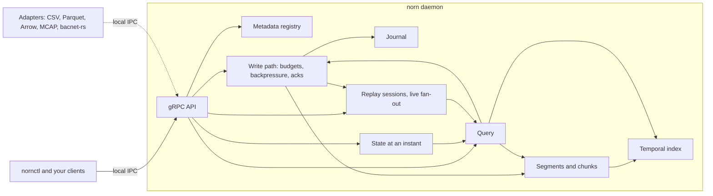
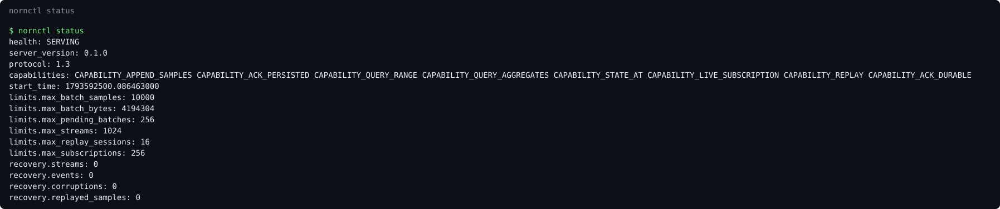

# Norn

A pure-Rust, domain-independent temporal data engine: it stores the history of systems, answers questions about it, and replays it.

[](https://github.com/oh-tarnished/norn/actions/workflows/ci.yml)
[](LICENSE)


**Status:** ingest, storage, compression, indexing, crash recovery, compaction,
retention, queries, state at any instant (`StateAt`), deterministic replay, live
subscriptions, import and export (CSV, Parquet, Arrow, MCAP) and an MCP server for AI
agents work. CI was green on Linux, macOS and Windows at 7526100; compaction, retention,
import, export and MCP came after that commit and have been tested on macOS only so
far. See the [roadmap](#roadmap).

## Contents

**Guides**

| Guide                                             | What it covers                             | State     |
| ------------------------------------------------- | ------------------------------------------ | --------- |
| [Getting started](docs/guides/getting-started.md) | build, run, create, append, list           | works     |
| [Configuration](docs/guides/configuration.md)     | every key and its default                  | works     |
| [Ingesting data](docs/guides/ingesting-data.md)   | batches, acknowledgements, backpressure    | works     |
| [Operations](docs/guides/operations.md)           | stopping, data directory, recovery, damage | partly    |
| [Troubleshooting](docs/guides/troubleshooting.md) | real errors and what they mean             | works     |
| [Querying](docs/guides/querying.md)               | ranges, filters, aggregates, resuming      | works     |
| [Replay and state](docs/guides/replay.md)         | state at T, replay, live subscriptions     | works     |
| [Import and export](docs/guides/import-export.md) | CSV, Parquet, Arrow, MCAP, both ways       | works     |
| [AI agents](docs/guides/ai-agents.md)             | `norn-mcp`, a client config, a session     | works     |

**Reference**

| Reference                                      | What it covers                                   | State         |
| ---------------------------------------------- | ------------------------------------------------ | ------------- |
| [Architecture](docs/reference/architecture.md) | layers, dependency table, process model          | current       |
| [Protocol](docs/reference/protocol.md)         | the gRPC API, errors, versioning                 | current       |
| [Storage](docs/reference/storage.md)           | file format, write path, recovery, index, codecs | current       |
| [IPC](docs/reference/ipc.md)                   | transports, endpoints, security model            | current       |
| [nornctl](docs/reference/cli.md)               | every command                                    | current       |
| [Query](docs/reference/query.md)               | read path, StateAt, exact semantics, bounds      | current       |
| [Replay](docs/reference/replay.md)             | virtual clock, sessions, subscriptions, bounds   | current       |
| [Adapters](docs/reference/adapters.md)         | the contract, CSV, Parquet, Arrow, MCAP formats  | current       |
| [MCP](docs/reference/mcp.md)                   | the tools, bounds, continuations, errors         | current       |

**Project**

| Document                              | What it covers                        |
| ------------------------------------- | ------------------------------------- |
| [Performance](docs/performance.md)    | every measurement and how it was made |
| [Specification](docs/project/spec.md) | the binding brief                     |
| [Plan](docs/project/plan.md)          | how the work is split                 |

**Images**, captured from a real daemon by
[`tools/screenshots/capture.sh`](tools/screenshots/capture.sh):
[status](docs/images/nornctl-status.svg),
[version](docs/images/nornctl-version.svg),
[signals](docs/images/nornctl-signals.svg),
[append](docs/images/nornctl-append.svg),
[query](docs/images/nornctl-query.svg),
[streams](docs/images/nornctl-streams.svg).

## What it is

Norn is a local daemon. Applications send it timestamped samples over gRPC on a
Unix socket; it compresses them losslessly, stores them in checksummed segments
and indexes them by time. It knows entities, signals and streams, never what they
mean. Building telemetry over BACnet is the first workload, but nothing in the
engine knows that.



## Quick start

Uses Rust 1.99.1, pinned in `rust-toolchain.toml`. No C toolchain.

```sh
cargo build -p norn-server -p norn-cli -p norn-mcp
./target/debug/norn
```

Release archives for Linux, macOS and Windows carry the same three binaries: `norn`,
`nornctl` and `norn-mcp` ([getting started](docs/guides/getting-started.md#build)).

Then, in another terminal, with `target/debug` on your `PATH`:

```console
$ nornctl status
health: SERVING
server_version: 0.1.0
protocol: 1.4
capabilities: CAPABILITY_APPEND_SAMPLES CAPABILITY_ACK_PERSISTED CAPABILITY_QUERY_RANGE CAPABILITY_QUERY_AGGREGATES CAPABILITY_STATE_AT CAPABILITY_LIVE_SUBSCRIPTION CAPABILITY_REPLAY CAPABILITY_COMPACTION CAPABILITY_RETENTION CAPABILITY_VERIFY CAPABILITY_ACK_DURABLE
start_time: 1793625040.270890000
limits.max_batch_samples: 10000
limits.max_batch_bytes: 4194304
limits.max_pending_batches: 256
limits.max_streams: 1024
limits.max_replay_sessions: 16
limits.max_subscriptions: 256
recovery.streams: 0
recovery.events: 0
recovery.corruptions: 0
recovery.replayed_samples: 0
recovery.clean_streams: 0
recovery.verified_segments: 0
recovery.vouched_segments: 0
compaction.runs: 0
compaction.segments: 0
compaction.saved_bytes: 0
compaction.failures: 0
retention.segments: 0
retention.samples: 0
retention.bytes: 0
$ nornctl streams create plant
streams/plant
$ nornctl entities create ahu-01
entities/ahu-01
$ nornctl signals create ahu-01 supply-temp plant double
entities/ahu-01/signals/supply-temp
$ nornctl signals create ahu-01 fan-speed plant double
entities/ahu-01/signals/fan-speed
$ nornctl append plant entities/ahu-01/signals/supply-temp 21.5
BACKPRESSURE_OUTCOME_ACCEPT ACKNOWLEDGEMENT_LEVEL_BUFFERED
BACKPRESSURE_OUTCOME_ACCEPT ACKNOWLEDGEMENT_LEVEL_DURABLE
$ nornctl query entities/ahu-01/signals/supply-temp
2026-11-02T02:50:11.174288Z entities/ahu-01/signals/supply-temp 21.5 GOOD seq=0
$ nornctl query entities/ahu-01/signals/supply-temp --agg average
- - entities/ahu-01/signals/supply-temp 21.5 count=1
$ nornctl streams
streams/plant samples=1 buffered=1
$ nornctl append plant entities/ahu-01/signals/supply-temp 21.9 --ack persisted
BACKPRESSURE_OUTCOME_ACCEPT ACKNOWLEDGEMENT_LEVEL_BUFFERED
BACKPRESSURE_OUTCOME_ACCEPT ACKNOWLEDGEMENT_LEVEL_PERSISTED
$ nornctl append plant entities/ahu-01/signals/fan-speed 40 --ack persisted
BACKPRESSURE_OUTCOME_ACCEPT ACKNOWLEDGEMENT_LEVEL_BUFFERED
BACKPRESSURE_OUTCOME_ACCEPT ACKNOWLEDGEMENT_LEVEL_PERSISTED
$ nornctl state ahu-01
state_time: 2026-11-02T02:50:13.233494Z
2026-11-02T02:50:13.229454Z entities/ahu-01/signals/fan-speed 40 GOOD seq=0
2026-11-02T02:50:13.224455Z entities/ahu-01/signals/supply-temp 21.9 GOOD seq=0
```

A sample is queryable the moment it is acknowledged, and `state` shows what every
signal held at an instant. `buffered` is how many are not in
a chunk yet: they are safe in the journal and reach one within a minute. The
[getting started guide](docs/guides/getting-started.md) walks through this, and
[querying](docs/guides/querying.md) goes further.

## How it works

### One API, over local IPC

Everything goes through the public gRPC API, and `nornctl` has no private door.
Protobuf under [`protobuf/`](protobuf) is the source of truth, and clients negotiate a
protocol version.


More: [protocol](docs/reference/protocol.md), [IPC](docs/reference/ipc.md).

### Entities, signals and streams

An entity is a thing, a signal is something measurable about it, and a stream is
the sequence its samples go into. Domain meaning lives in opaque metadata.


More: [getting started](docs/guides/getting-started.md#create-a-stream-an-entity-and-a-signal).

### Appends say how far they got

Every batch hears an outcome (`ACCEPT`, `BUFFER`, `THROTTLE`, `REJECT`) and then the
level it reached (`BUFFERED`, `PERSISTED`, `DURABLE`). Memory is budgeted per
subsystem; when a budget runs out clients are slowed or refused, and telemetry is
never dropped silently.


More: [ingesting data](docs/guides/ingesting-data.md).

### Stored in compressed, checksummed chunks

Samples are journalled, then encoded per signal into chunks (delta-of-delta
timestamps, Gorilla floats, dictionaries and more, with pure-Rust zstd at levels 3
to 6). Chunks sit in sealed segment files, and a sparse temporal index finds them
without opening a segment.


More: [storage](docs/reference/storage.md).

### Queries see everything acknowledged

A query merges chunks with what is still in memory, so a sample is visible as soon as
it is acknowledged, exactly once across the moment it reaches a chunk. Ranges, filters
on value and quality, and `LATEST`, `FIRST`, `LAST`, `COUNT`, `MIN`, `MAX`, `AVERAGE`,
`SUM` and `RATE` over fixed windows stream in bounded memory, and resume from a token.
A damaged chunk is an error, never a gap.


More: [querying](docs/guides/querying.md), [query](docs/reference/query.md).

### History, at any instant and played back

`nornctl state` shows what every signal held at an instant, straight from the index:
no checkpoints, since measurement showed they would be slower. A replay session plays a
stretch of history on a virtual clock you pause, seek, step and speed up, emitting the
same events in the same order every time; a seek first tells you the state there. Live
data arrives through the same subscription and event format.

```console
$ nornctl subscribe replay morning --resume
#1 2026-11-02T08:00:00Z RUNNING
#2 2026-11-02T08:00:00Z 2026-11-02T08:00:00Z entities/ahu-01/signals/fan-speed 40 GOOD seq=0
#3 2026-11-02T08:00:00Z 2026-11-02T08:00:00Z entities/ahu-01/signals/supply-temp 21 GOOD seq=0
```

More: [replay and state](docs/guides/replay.md), [replay](docs/reference/replay.md).

### AI agents read history through MCP

`norn-mcp` is a separate executable an agent's client launches: ten read-only tools
(`list_entities`, `list_signals`, `get_signal_metadata`, `query_range`, `get_latest`,
`state_at`, `find_events`, `get_statistics`, `compare_periods`, `replay`), each a
deterministic primitive over the public gRPC API. Every result is bounded and resumes
from a continuation; failures carry a stable reason and a hint. Over HTTP it binds
loopback only and refuses an unknown `Host`.

```json
// find_events {"target": "entities/ahu-01/signals/fan-on", "kind": "value_change"}
{"complete": true, "continuation": null, "count": 2, "rows": [
  {"event": "value_change", "previous": false, "time": "2026-11-02T08:01:00Z", "value": true, ...},
  {"event": "value_change", "previous": true, "time": "2026-11-02T08:04:00Z", "value": false, ...}
], "samples_scanned": 6}
```

More: [AI agents](docs/guides/ai-agents.md), [MCP](docs/reference/mcp.md).

### Crashes and damage are reported, not hidden

Each start replays the journal, verifies whatever a crash could have touched, and
`nornctl status` says what it found; `nornctl verify` checks everything. After
`kill -9`:



```text
recovery.streams: 1
recovery.events: 1
recovery.corruptions: 0
recovery.replayed_samples: 1
```

The image shows a clean start; the block is the real result of a kill. More:
[operations](docs/guides/operations.md#crash-recovery).

## Measured numbers

All on one Apple M3 Max with a local SSD, release builds. Nothing has been measured on
Linux or Windows yet, though CI tests both. Full tables and methods:
[performance](docs/performance.md).

| What                               | Result                   | How it was measured                                                                                   |
| ---------------------------------- | ------------------------ | ----------------------------------------------------------------------------------------------------- |
| Sustained append, `DURABLE`        | 16,044 samples/s         | `norn` over gRPC on a Unix socket, 30 s, 16,000 signals, one call. p50 18.11 ms, p99 29.26 ms         |
| Burst append, `DURABLE`            | 120,010 samples/s        | same, 15 s. p50 16.34 ms, p99 22.68 ms. The offered rate was met, so the maximum is unmeasured        |
| Startup, 115 M samples             | 88–94 ms; 2.6 s unmarked | `norn` spawn to first answer after a clean stop; with the marker removed; warm page cache. 1.19 s after `kill -9` |
| Peak daemon RSS                    | 110 MiB of 512 MiB       | across the four write-path runs, a 21% share of the default budget                                    |
| Storage, compacted                 | 1.200 bytes/sample       | 57.6 million samples, one hour at 16,000 × 1 Hz, in an assumed mix of signal shapes                   |
| Storage, ingest layout             | 2.195 bytes/sample       | same hour, before compaction                                                                          |
| A year, compacted                  | about 0.61 TB            | **extrapolated**, linearly, from that one hour. Not a measured year; a noisy site could reach 3.45 TB |
| Index startup, compacted year      | 32.0 ms                  | 16,000 signals, 8,760 segments, 140.2 million chunks; real files, chunk bodies left out               |
| Index lookup, one signal, one hour | p50 49.5 µs, p99 6.53 ms | same dataset, empty index cache, single-threaded; locates chunks and does not read them               |
| gRPC round trip, Unix socket       | p50 31 µs, p99 45–50 µs  | unary health check, 20,000 calls, two runs                                                            |
| Query, one signal, one hour        | p50 1.41 ms, p99 2.29 ms | 3,600 raw samples through gRPC on a Unix socket; 200 signals × 1 Hz × 1 day, a scaled-down set        |
| Query, one signal, one day         | p50 6.31 ms, p99 6.69 ms | AVERAGE per minute over 86,400 samples, 13.6 M samples/s; same set                                    |
| Query, all signals, latest         | p50 7.22 ms, p99 8.12 ms | LATEST of 200 signals; same set. Not measured at 16,000                                               |
| StateAt, all signals               | p50 83.0 ms, p99 349 ms  | 16,000 signals, random T, all pages through gRPC on a Unix socket; 15 minutes of data, scaled down    |
| StateAt, one signal                | p50 453 µs, p99 791 µs   | same set; scrubbing one signal in 5 s steps: p50 364 µs                                              |
| Replay, maximum speed              | 1.15 M samples/s         | all 14.4 million samples of that set to one subscriber over gRPC on a Unix socket, three runs         |
| Export, Parquet                    | 2.17 M samples/s         | `nornctl export`, 1 million samples (100 signals × 10,000 s), median of three; 1.66 bytes/sample      |
| Import, Parquet                    | 365 k samples/s          | `nornctl import` into a fresh daemon at `PERSISTED`, same data, median of three                       |

Caveats that matter:

- The year figure is linear extrapolation from one hour with an assumed signal mix.
  Measure a real site before sizing disks.
- Crash tests cover process death (`kill -9`), not power loss.
- Performance is measured on macOS only; Linux and Windows are tested in CI, not measured.
- Defaults in `norn_core::Config` were picked, not measured; stage 15 revisits them.

## Roadmap

One row per stage of [the specification](docs/project/spec.md#48-implementation-order).
✅ done, 🚧 in progress, ⬜ planned. ✅ means built and tested: CI builds, lints and
tests every push on Linux, macOS and Windows, and cross-compiles ARMv7 and AArch64
Linux. It was last green on all three at 7526100, before stages 13 and 14 and the
daemon's compaction and retention, which have been tested on macOS only so far. Tests that need Unix signals or Unix sockets run on Linux and macOS only;
[operations](docs/guides/operations.md#platforms) lists them.

| Stage | Subject       | Scope                                                       | State | Today                                                               |
| ----- | ------------- | ----------------------------------------------------------- | ----- | ------------------------------------------------------------------- |
| 1     | Foundation    | workspace, docs, core types, errors, config, gates          | ✅    |                                                                     |
| 2     | Protocol      | Protobuf, gRPC, buf, AIP lint, versioning                   | ✅    | 1.4; `ExportStream` unimplemented by decision: export is client-side |
| 3     | IPC           | Unix sockets, named pipes, transport, framing               | ✅    | named pipes run in CI on `windows-latest`: `nornctl` against a real daemon, and the owner-only DACL |
| 4     | Basic daemon  | lifecycle, config, health                                   | ✅    |                                                                     |
| 5     | Storage       | format, chunks, segments, checksums, recovery               | ✅    | compaction, retention, `verify` and a clean-start marker run in the daemon |
| 6     | Encoding      | timestamp, integer, float, boolean, enum, zstd              | ✅    |                                                                     |
| 7     | Index         | sparse temporal index, rebuild                              | ✅    | a per-signal summary answers for silent signals                     |
| 8     | Write path    | append, batch, backpressure, durability                     | ✅    | live subscribers fed from the commit thread, never waited for      |
| 9     | Query         | range, latest, aggregates                                   | ✅    | sees buffered samples; measured at 200 signals, not 16,000          |
| 10    | State         | checkpoints, `StateAt`                                      | ✅    | `StateAt` from the index; checkpoints measured and deferred         |
| 11    | Replay        | virtual clock, pause, seek, speed                           | ✅    | sessions in memory, ended by a restart                              |
| 12    | Shared memory | ring buffer, fallback                                       | ⬜    | the `DataPlane` trait is the only code                              |
| 13    | Adapters      | BACnet, MCAP, Parquet, others                               | ✅    | CSV, Parquet, Arrow IPC and MCAP, export and import through `nornctl`; BACnet is a sink in bacnet-rs over IPC, under review there; no Modbus, OPC-UA or MQTT |
| 14    | MCP           | MCP server and the rest of `nornctl`                        | ✅    | `norn-mcp`: ten read-only tools, stdio or loopback-only HTTP; `nornctl` adds export, import, compact, verify, retention; no `inspect`, `stats` or `benchmark` yet |
| 15    | Optimisation  | measured defaults, the full benchmark matrix                | ⬜    | write path, storage, index, query and IPC measured once             |
| 16    | Hardening     | fuzzing, crash, corruption, cross-platform, security review | 🚧    | crash and corruption tests exist (Unix only: they `kill -9`); CI on Linux, macOS, Windows; no fuzzing, no review |

## Contributing

Read [CONTRIBUTING.md](CONTRIBUTING.md). In short: no source file reaches 200 lines,
no C, no `unsafe`, and `just ci` must pass, including the repository gates.

```sh
just test    # every test, including the tests proving each gate bites
just lint    # fmt --check and clippy -D warnings
just gates   # size, purity, docs, arch, deps
just ci      # everything CI runs
```

## Security

Report vulnerabilities privately: see [SECURITY.md](SECURITY.md).

## Licence

Copyright © 2026 Srikanth K. All rights reserved, except as granted below.

Norn is dual-licensed:

- **[AGPL-3.0-or-later](LICENSE)** for open-source use.
- **[Commercial](LICENSE-COMMERCIAL.md)** for proprietary use under a separate agreement.

This covers every part of Norn, with no exception: the engine, the server, the
client and protocol crates, their generated code, and the `.proto` definitions
under [`protobuf/`](protobuf). A proprietary client built on any of them needs
a commercial licence.

Contributions follow the [Contributor Licence Agreement](.github/CLA.md);
sign off each commit with `git commit -s`. Third-party dependencies retain
their own licences; `deny.toml` keeps those dependencies permissively licensed.
