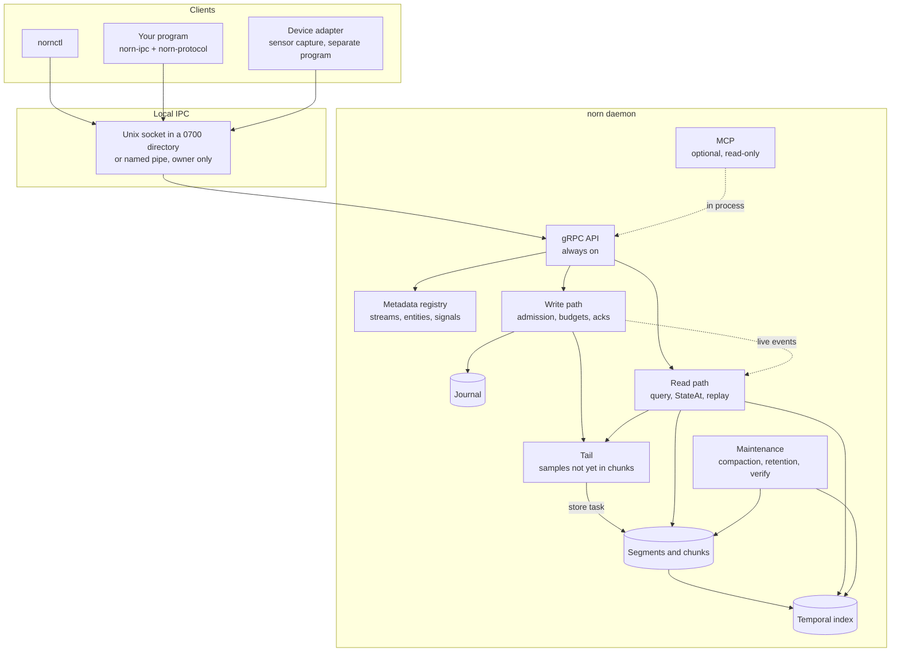
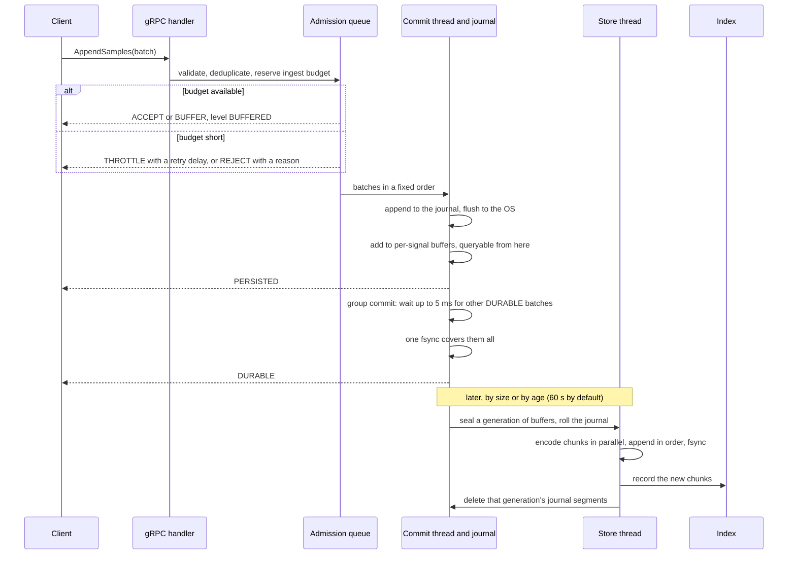
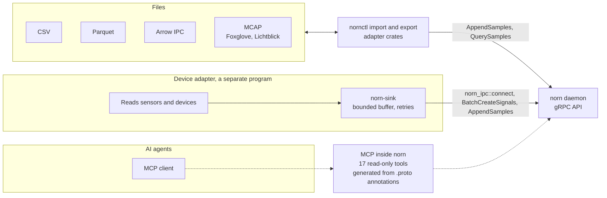
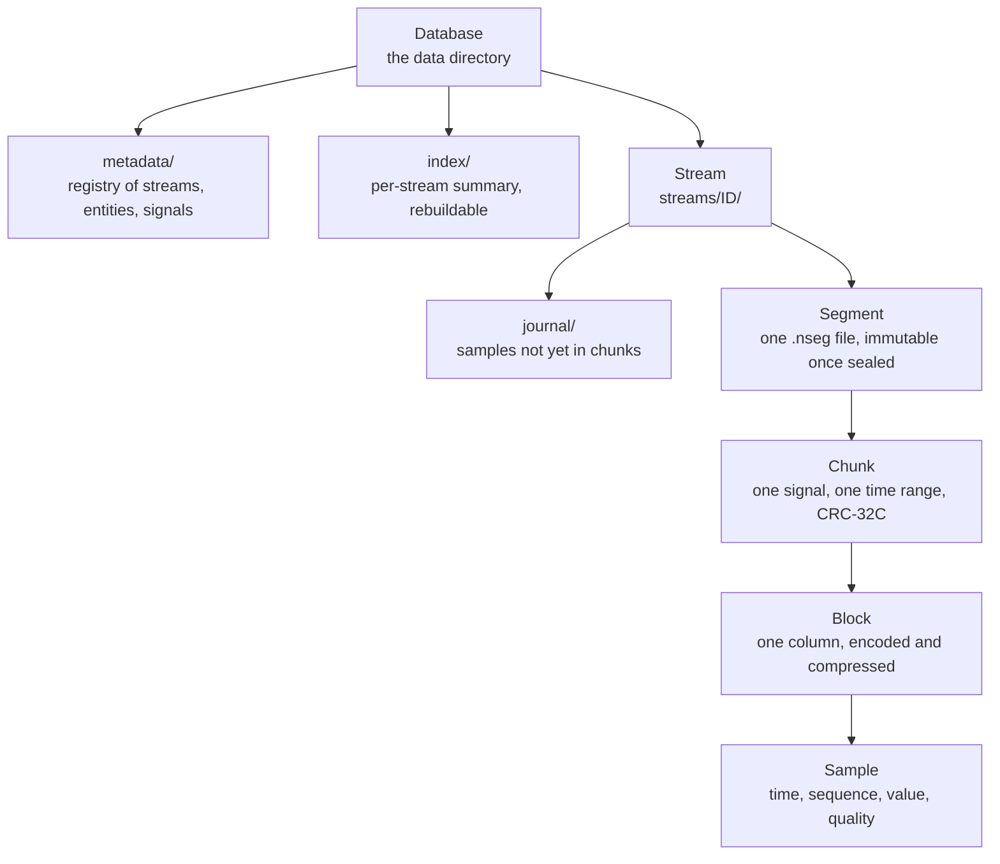
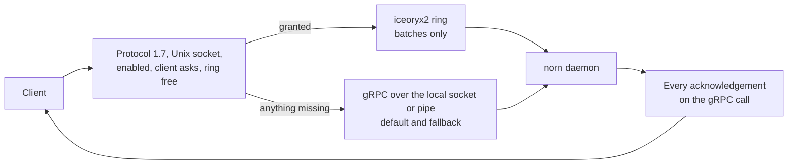
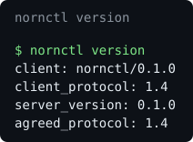
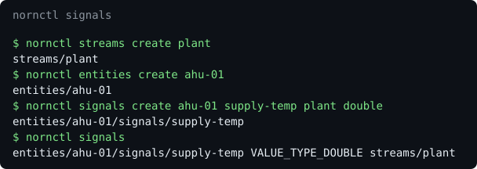
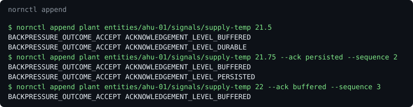
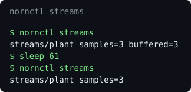
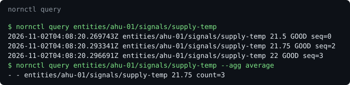

<!--
SPDX-FileCopyrightText: 2026 Srikanth K
SPDX-License-Identifier: AGPL-3.0-or-later
-->

<div align="center">

<h1>Norn</h1>

<p><strong>A pure-Rust, domain-independent temporal data engine.</strong><br>
It stores the history of sensor data and device telemetry, answers questions about any instant of it, and replays it.</p>

<p>
<a href="https://github.com/shokki-engineering/norn/actions/workflows/ci.yml"></a>
<a href="https://github.com/shokki-engineering/norn/releases"></a>
<a href="LICENSE"></a>
<a href="rust-toolchain.toml"></a>
<a href="https://github.com/shokki-engineering/norn/commits/main"></a>
</p>

<p>
<a href="#installation"></a>
<a href="https://grpc.io"></a>
<a href="protobuf"></a>
<a href="https://modelcontextprotocol.io"></a>
<a href="docs/reference/architecture.md#no-c"></a>
</p>

<p>
<a href="https://tokio.rs"></a>
<a href="https://github.com/hyperium/tonic"></a>
<a href="buf.yaml"></a>
<a href="https://parquet.apache.org"></a>
<a href="https://arrow.apache.org"></a>
<a href="https://mcap.dev"></a>
</p>

</div>

Norn is a local daemon. Programs send it timestamped samples over gRPC on a Unix
socket or a Windows named pipe. It journals them, compresses them losslessly into
checksummed chunks, indexes them by time, and answers range queries, aggregates, the
state of every signal at an instant, and deterministic replays. It knows entities,
signals and streams, and never what they mean.

**Next release: `norn v1.0.0-rc.1`.** The daemon, `nornctl`, interchange adapters,
MCP server and protocol crate are versioned together at `1.0.0-rc.1`. This release
candidate adds an opt-in [shared-memory](#shared-memory) data plane and the
stability work under [Operations](#operations). The wire protocol negotiates
version 1.7. Homebrew installs the complete program; start the background service
with `brew services start norn`. See the [changelog](docs/project/changelog.md)
and [Installation](#installation). v0.1.0 remains the published release until the
release candidate is published.

## Contents

**This page**

- [What it is and why](#what-it-is-and-why)
- [Features](#features)
- [Architecture](#architecture): [system](#the-whole-system),
  [servers](#servers-always-on-and-optional), [write path](#the-write-path),
  [read path](#the-read-path), [adapters and MCP](#adapters-and-mcp),
  [storage](#storage-hierarchy)
- [Shared memory](#shared-memory)
- [Installation](#installation)
- [Quick start](#quick-start)
- [How it works](#how-it-works)
- [Configuration](#configuration)
- [Using Norn from your own code](#using-norn-from-your-own-code)
- [Operations](#operations)
- [Performance](#performance)
- [Roadmap](#roadmap)
- [Contributing](#contributing), [Security](#security), [Licence](#licence)

**Guides**

- [Getting started](docs/guides/getting-started.md): build, run, create, append, list
- [Homebrew](docs/guides/homebrew.md): installation, the background service, upgrades, release automation
- [Configuration](docs/guides/configuration.md): every key and its default
- [Ingesting data](docs/guides/ingesting-data.md): batches, acknowledgements, backpressure
- [Operations](docs/guides/operations.md): starting, stopping, the data directory, recovery, damage, verify, compaction, retention
- [Troubleshooting](docs/guides/troubleshooting.md): real errors and what they mean
- [Querying](docs/guides/querying.md): ranges, filters, aggregates, resuming
- [Replay and state](docs/guides/replay.md): state at an instant, replay, live subscriptions
- [Import and export](docs/guides/import-export.md): CSV, Parquet, Arrow, MCAP, both ways
- [AI agents](docs/guides/ai-agents.md): `norn --mcp`, a client configuration
- [Writing a device adapter](docs/guides/device-adapter.md): `norn-sink`, step by step, with a complete example

**Reference**

- [Architecture](docs/reference/architecture.md): layers, dependency table, process model
- [Protocol](docs/reference/protocol.md): the gRPC API, errors, versioning
- [Storage](docs/reference/storage.md): file format, write path, recovery, index, codecs
- [Compatibility](docs/reference/compatibility.md): on-disk format versions, the protocol, the support window
- [IPC](docs/reference/ipc.md): transports, endpoints, security model
- [Shared memory](docs/reference/shared-memory.md): the opt-in iceoryx2 data plane, settings, limits, trust boundary and crash handling
- [Query](docs/reference/query.md): read path, StateAt, exact semantics, bounds
- [Replay](docs/reference/replay.md): virtual clock, sessions, subscriptions, bounds
- [Adapters](docs/reference/adapters.md): the contract, CSV, Parquet, Arrow, MCAP formats
- [nornctl](docs/reference/cli.md): every command
- [MCP](docs/reference/mcp.md): the daemon's 17 read-only tools and transports

**Security**

- [Security review, November 2026](docs/security/review-2026-11.md): threat model, findings, fixes, what was not examined

**Project**

- [Changelog](docs/project/changelog.md): upcoming v1.0.0-rc.1 and the v0.1.0 release
- [Performance](docs/performance.md): every measurement and how it was made
- [Specification](docs/project/spec.md): the binding brief
- [Plan](docs/project/plan.md): how the work is split, and its status

**Images**, captured from a real daemon by
[`tools/screenshots/capture.sh`](tools/screenshots/capture.sh):
[status](docs/images/nornctl-status.svg),
[version](docs/images/nornctl-version.svg),
[signals](docs/images/nornctl-signals.svg),
[append](docs/images/nornctl-append.svg),
[query](docs/images/nornctl-query.svg),
[streams](docs/images/nornctl-streams.svg).

## What it is and why

Many systems need the same thing from their sensor data: keep years of it on one
machine, lose nothing that was acknowledged, and answer "what did the system look
like at 08:00:15, and what happened around it?" quickly. Norn does that one job, for
any domain.

- **One process, local.** A daemon owns a data directory. Clients reach it only
  through local IPC. There is no network listener and no external database.
- **Domain-independent.** The core knows entities, signals, streams, samples, values,
  timestamps, sequences and quality. Device telemetry is the first workload, but no
  device, protocol or industry term appears in the engine. Domain facts travel as
  opaque annotations.
- **Time first.** Storage, indexing, queries, state at an instant and replay are all
  organised around time.
- **Pure Rust, no TLS.** No C in any shipped dependency graph, and no C toolchain to
  build it (`xtask deps` enforces both). The daemon serves local IPC only, so no TLS
  stack is linked. `unsafe` is denied workspace-wide, with one audited exception: the
  owner-only security descriptor for Windows named pipes.
- **Bounded.** Every memory budget and count limit is configured and enforced. When a
  budget runs out, clients are slowed or refused, and nothing is dropped silently.

## Features

- **Append over gRPC, with backpressure and acknowledgement levels**: Done. `ACCEPT`, `BUFFER`, `THROTTLE`, `REJECT`; `BUFFERED` to `DURABLE`
- **Batch creates (protocol 1.6)**: Done. `BatchCreateEntities` and `BatchCreateSignals`, up to 1,000 a call, all or none, one durable commit
- **Journal, group commit, fsync**: Done. `DURABLE` only after `fsync` returns
- **Compressed, checksummed chunks in segment files**: Done. Delta-of-delta, Gorilla, ALP, dictionaries, zstd levels 3 to 6
- **Sparse temporal index**: Done. Rebuilt from the segments if lost
- **Range queries, filters, aggregates, resume tokens**: Done. Sees samples as soon as they are acknowledged
- **State at an instant (`StateAt`)**: Done. From the index; checkpoints measured and not needed
- **Deterministic replay and live subscriptions**: Done. Virtual clock: pause, seek, step, speed
- **Crash recovery**: Done. Tested by killing the process, not by cutting power
- **Compaction, retention, verification**: Done. In the background and on demand; see [Operations](#operations)
- **Import and export: CSV, Parquet, Arrow IPC, MCAP**: Done. Through `nornctl`, over the public API
- **`nornctl` command-line client**: Done, including `inspect`, `stats` and `benchmark`
- **MCP for AI agents, served by the daemon**: Done. `norn --mcp`, 17 read-only tools; off by default. See [MCP](#mcp)
- **Homebrew package and background service**: Done. `brew services start norn`
- **Shared-memory data plane**: Done, in 1.0.0-rc.1 (protocol 1.7). Opt-in, Unix sockets only, transparent socket fallback; see [Shared memory](#shared-memory)
- **Stability**: Done, in 1.0.0-rc.1. Verify reads the open segment, sealing by open time, a shutdown that no open call delays, macOS durability documented
- **Pattern detection, GGML-accelerated**: Planned. Opt-in, outside the engine; scope still to be decided
- **Security review**: Done, a first source review ([review](docs/security/review-2026-11.md)); its open findings are listed there
- **Fuzzing**: Planned. Stage 16
- **Encryption at rest**: Done, opt-in: chunk data, journals included; names and time ranges are not encrypted ([storage](docs/reference/storage.md#encryption))
- **Further device-protocol adapters**: Planned. As clients of the public API, outside this repository
- **Backup, restore, migration**: Built, unreleased. `nornctl backup`, `restore`, `migrate`; see [operations](docs/guides/operations.md#backup-and-restore)
- **Metrics export**: Not built

## Architecture

### The whole system



The daemon is one process. Its runtime owns the IPC server, the health mirror and the
maintenance worker. `Runtime::new` spawns nothing; `run` owns every task and returns
only when all have stopped. Details: [architecture](docs/reference/architecture.md).

### Servers: always on and optional

- **gRPC**: Always on. It cannot be disabled. It is the only API. `nornctl`, the adapters and every client use it; nothing reaches storage another way.
- **MCP**: Optional and off by default. Served inside `norn` with `norn --mcp TRANSPORT` or `[mcp] enabled = true`, over stdio, a local socket or pipe, or loopback HTTP. No separate MCP executable is needed.
- **Shared-memory data plane**: Optional and off by default, from 1.0.0-rc.1 (protocol 1.7). Unix sockets only; the socket stays the control plane. See [Shared memory](#shared-memory).
- **InfluxDB**: Not used. Norn has no InfluxDB dependency.

### The write path



Each batch hears two answers: its admission, then the level it asked for. A failed
`fsync` poisons the journal writer, every waiting batch gets an error, and the next
start runs recovery. Details: [ingesting data](docs/guides/ingesting-data.md),
[storage](docs/reference/storage.md).

### The read path


Reading the tail before taking the index snapshot means a sample acknowledged at
`PERSISTED` is always in one or the other, so a query sees it exactly once. Details:
[query](docs/reference/query.md), [replay](docs/reference/replay.md).

### Adapters and MCP



Every adapter is a client of the public gRPC API and nothing else. Device-protocol
adapters live outside this repository and use only Norn's public client crates
(`norn-ipc`, `norn-protocol`); a device's details become annotations that Norn stores
and never interprets. Formats and the adapter contract:
[adapters](docs/reference/adapters.md).

### Storage hierarchy



A segment is append-only while open and immutable once sealed. A chunk is encoded,
compressed and checksummed independently of every other chunk, so damage is found
and reported per chunk. File formats: [storage](docs/reference/storage.md).

## Shared memory

**Built, landing in Norn 1.0.0-rc.1 with protocol 1.7.** Not in v0.1.0.

An opt-in data plane for bulk sensor data: `AppendSamples` batches travel from a
client on the same machine through a bounded [iceoryx2](https://github.com/eclipse-iceoryx/iceoryx2)
ring in shared memory, while the Unix socket stays the control plane and carries every
response. The rules:

- **Off by default.** The daemon offers rings only with `[shared_memory] enabled = true`,
  and a client uses one only when it asks.
- **Unix sockets only, never Windows.** Only the socket's `0700` directory proves the
  client is the daemon's user, and iceoryx2 0.10 cannot make a Windows mapping
  owner-only. On a named pipe or TCP, or on Windows, every call stays on the socket.
- **Transparent fallback.** An older daemon, shared memory off, no ring free, a failed
  attach or a batch larger than a frame: the call carries on over the socket, on the
  same call, with nothing for the caller to do.
- **The same answers.** Every batch goes through the same handler as a socket batch,
  with the same validation, backpressure, ordering and `RECEIVED` to `DURABLE`
  acknowledgements, all on the gRPC response stream. A full ring makes the writer
  wait; nothing is dropped.
- **Trust boundary: the daemon's user.** Another user cannot open a ring, but a
  misbehaving process of the daemon's own user can crash the daemon by writing into
  iceoryx2's shared bookkeeping. Enable it only where every process of that user is
  trusted ([SECURITY.md](SECURITY.md)).

Try it from `nornctl`, comparing the two planes on fresh daemons:

```sh
nornctl append plant entities/dev-01/signals/temperature 21.5 --shared-memory
nornctl import samples.parquet --ack buffered --timing           # the socket
nornctl import samples.parquet --ack buffered --shared-memory    # a ring
```

`append --shared-memory` prints `plane SHARED_MEMORY` when its sample went through a
ring, and `import --timing` (implied by `--shared-memory`) adds
`timing seconds= samples_per_second=`. Settings, protocol fields and gates:
[shared memory](docs/reference/shared-memory.md).



## Installation

### Homebrew on macOS and Linux

Install Norn 0.1.0 from `shokki-engineering/homebrew-tap`, then start its background
service. The tap and archives are public; no GitHub token is needed.

```sh
brew install shokki-engineering/tap/norn
brew services start norn
nornctl --endpoint "unix:$(brew --prefix)/var/run/norn/norn.sock" status
```

Installation supplies `norn` and `nornctl`; starting the service is explicit. The
service runs at login and restarts after a crash. It keeps data in
`$(brew --prefix)/var/norn`, serves gRPC on the owner-only socket
`$(brew --prefix)/var/run/norn/norn.sock`, and logs to
`$(brew --prefix)/var/log/norn.log`. Edit `$(brew --prefix)/etc/norn/norn.toml` to
configure it; MCP is off by default. After `brew upgrade norn`, run
`brew services restart norn`. Full setup and upgrade details:
[Homebrew](docs/guides/homebrew.md).

### Building from source: prerequisites

- **Rust**: 1.99.1. Pinned in `rust-toolchain.toml`; `rustup` installs it on first build
- **`protoc`**: 36.2 is used in CI. The daemon's runtime-rs validation dependency
  compiles its own protobuf types during the build; Norn's generated code is committed
- **C toolchain**: None. The build links no C library and no TLS stack
- **Operating system**: Linux, macOS, Windows. Linux release builds need glibc 2.35 or newer
- **`just`**: Any recent. Optional; runs the same commands CI runs

Working on Norn itself also needs Buf 1.75.0, cargo-deny 0.20.2 and Go for the AIP
linter: see [CONTRIBUTING.md](CONTRIBUTING.md).

### Build from source

```sh
git clone https://github.com/shokki-engineering/norn.git
cd norn
git checkout v0.1.0
cargo build --release --locked -p norn-server -p norn-cli
```

This builds `target/release/norn`, the daemon, and `target/release/nornctl`, the
command-line client. Put that directory on your `PATH` for the commands below.

### Release archives

Download [Norn v0.1.0](https://github.com/shokki-engineering/norn/releases/tag/v0.1.0).
The [release workflow](.github/workflows/release.yml) builds one archive per
target and publishes each with a `.sha256` file to check it against:

- `x86_64-unknown-linux-gnu`: Ubuntu 22.04
- `aarch64-unknown-linux-gnu`: Ubuntu 22.04 ARM
- `aarch64-apple-darwin`: macOS 15
- `x86_64-apple-darwin`: macOS 15 Intel
- `x86_64-pc-windows-msvc`: Windows

Each archive carries the binaries (`.exe` on Windows), this README, the documentation
and the licences.

## Quick start

For a source build, use two terminals. Start the daemon in the first:

```sh
cargo build -p norn-server -p norn-cli
./target/debug/norn
```

In the second, put `target/debug` on your `PATH` and run the commands below. Homebrew
users can use their running service by adding
`--endpoint "unix:$(brew --prefix)/var/run/norn/norn.sock"` to `nornctl` calls. The
output was captured from Norn 0.1.0 on macOS.

**Check the connection and create a catalogue.** `version` negotiates the protocol.

```console
$ nornctl version
client: nornctl/0.1.0
client_protocol: 1.6
server_version: 0.1.0
agreed_protocol: 1.6
$ nornctl streams create plant
streams/plant
$ nornctl entities create dev-01
entities/dev-01
$ nornctl signals create dev-01 temperature plant double
entities/dev-01/signals/temperature
$ nornctl signals create dev-01 frequency plant double
entities/dev-01/signals/frequency
```

**Append.** Each batch hears its admission, then the level it reached.

```console
$ nornctl append plant entities/dev-01/signals/temperature 21.0 --at 2026-11-02T08:00:00Z --sequence 1
BACKPRESSURE_OUTCOME_ACCEPT ACKNOWLEDGEMENT_LEVEL_BUFFERED
BACKPRESSURE_OUTCOME_ACCEPT ACKNOWLEDGEMENT_LEVEL_DURABLE
```

Five more were appended the same way: `frequency` 40 at 08:00:00, `temperature` 21.4
at 08:00:10, `frequency` 55 at 08:00:20, and `temperature` 21.9 at 08:00:30, sent
twice with the same sequence number.

**Query.** The resend is stored once.

```console
$ nornctl query dev-01 --order time
2026-11-02T08:00:00Z entities/dev-01/signals/temperature 21 GOOD seq=1
2026-11-02T08:00:00Z entities/dev-01/signals/frequency 40 GOOD seq=2
2026-11-02T08:00:10Z entities/dev-01/signals/temperature 21.4 GOOD seq=3
2026-11-02T08:00:20Z entities/dev-01/signals/frequency 55 GOOD seq=4
2026-11-02T08:00:30Z entities/dev-01/signals/temperature 21.9 GOOD seq=5
$ nornctl query dev-01 --agg max --window 30s --from 2026-11-02T08:00:00Z --to 2026-11-02T08:01:00Z
2026-11-02T08:00:00Z 2026-11-02T08:00:30Z entities/dev-01/signals/frequency 55 count=2
2026-11-02T08:00:00Z 2026-11-02T08:00:30Z entities/dev-01/signals/temperature 21.4 count=2
2026-11-02T08:00:30Z 2026-11-02T08:01:00Z entities/dev-01/signals/temperature 21.9 count=1
```

**State at an instant.** What every signal held at 08:00:15.

```console
$ nornctl state dev-01 --at 2026-11-02T08:00:15Z
state_time: 2026-11-02T08:00:15Z
2026-11-02T08:00:00Z entities/dev-01/signals/frequency 40 GOOD seq=2
2026-11-02T08:00:10Z entities/dev-01/signals/temperature 21.4 GOOD seq=3
```

**Replay.** A session starts paused; subscribing with `--resume` starts its clock.
`--speed max` plays as fast as the subscriber reads.

```console
$ nornctl replay create dev-01 --from 2026-11-02T08:00:00Z --to 2026-11-02T08:01:00Z --speed max --id morning
replaySessions/morning PAUSED at=2026-11-02T08:00:00Z emitted=0 pace=max from=2026-11-02T08:00:00Z to=2026-11-02T08:01:00Z
$ nornctl subscribe replay morning --resume
#1 2026-11-02T08:00:00Z RUNNING
#2 2026-11-02T08:00:00Z 2026-11-02T08:00:00Z entities/dev-01/signals/temperature 21 GOOD seq=1
#3 2026-11-02T08:00:00Z 2026-11-02T08:00:00Z entities/dev-01/signals/frequency 40 GOOD seq=2
#4 2026-11-02T08:00:10Z 2026-11-02T08:00:10Z entities/dev-01/signals/temperature 21.4 GOOD seq=3
#5 2026-11-02T08:00:20Z 2026-11-02T08:00:20Z entities/dev-01/signals/frequency 55 GOOD seq=4
#6 2026-11-02T08:00:30Z 2026-11-02T08:00:30Z entities/dev-01/signals/temperature 21.9 GOOD seq=5
#7 2026-11-02T08:01:00Z ENDED
```

**Where the samples are.** They are safe in the journal and still buffered: no
chunk has been written yet, so `verify` has nothing to read. A clean stop (Ctrl-C)
stores the buffers as chunks. After restarting `norn`, one more append at 08:00:40,
and another stop and start, the stream holds two segments:

```console
$ nornctl verify plant
streams/plant segments=2 chunks=3 samples=6 bytes=633 damaged_chunks=0 damaged_samples=0
```

**Compact, then verify.** Compaction merges neighbouring segments and re-encodes
each signal's chunks. `verify` then reads and checks every chunk again.

```console
$ nornctl compact plant
streams/plant chunks=3->2 bytes=633->408 skipped_segments=0
$ nornctl verify plant
streams/plant segments=1 chunks=2 samples=6 bytes=408 damaged_chunks=0 damaged_samples=0
```

**Export.** An export never overwrites a file.

```console
$ nornctl export dev-01 --format parquet --output dev-01.parquet
exported samples=6 signals=2 bytes=4452 to dev-01.parquet
$ nornctl export dev-01 --format csv --output dev-01.csv
exported samples=6 signals=2 bytes=989 to dev-01.csv
```

The file carries the catalogue too, so importing it into an empty daemon recreates the
stream, the entity and the signals:

```console
$ nornctl import dev-01.parquet --ack persisted
imported read=6 sent=6 present=0 duplicate=0 created=4 batches=1 throttled=0 retried=0
$ nornctl query dev-01 --agg count
- - entities/dev-01/signals/frequency 2 count=2
- - entities/dev-01/signals/temperature 4 count=4
```

**Shut down.** Ctrl-C or SIGTERM. In-flight calls drain and the exit status is 0.

```text
INFO shutdown requested signal="SIGTERM"
INFO runtime draining tasks=5
INFO ipc drained aborted=0
INFO runtime stopped aborted=0
INFO stopped aborted=0
```

Each step has a guide with more: [getting started](docs/guides/getting-started.md),
[querying](docs/guides/querying.md), [replay and state](docs/guides/replay.md),
[import and export](docs/guides/import-export.md).

## How it works

### One API, over local IPC

Everything goes through the public gRPC API, and `nornctl` has no private door.
Protobuf under [`protobuf/`](protobuf) is the source of truth, and clients negotiate a
protocol version, now 1.6. Every collection has the AIP standard methods; entities and
signals also have `BatchCreateEntities` and `BatchCreateSignals`, up to 1,000 a call,
all or nothing, with one durable commit per batch. A batch is safe to repeat: what
already exists is returned as stored, so an adapter sends its whole catalogue at every
start. That is how a network of 1,000 devices provisions about 60,000 signals without
dropping readings.



More: [protocol](docs/reference/protocol.md), [IPC](docs/reference/ipc.md).

### Entities, signals and streams

An entity is a thing, such as a sensor or a device; a signal is something measurable
about it, such as a temperature; and a stream is the sequence its samples go into.
Domain meaning lives in opaque metadata.



More: [getting started](docs/guides/getting-started.md#create-a-stream-an-entity-and-a-signal).

### Appends say how far they got

Every batch hears an outcome (`ACCEPT`, `BUFFER`, `THROTTLE`, `REJECT`) and then the
level it reached (`BUFFERED`, `PERSISTED`, `DURABLE`). Memory is budgeted per
subsystem; when a budget runs out clients are slowed or refused, and telemetry is
never dropped silently.



More: [ingesting data](docs/guides/ingesting-data.md).

### Stored in compressed, checksummed chunks

Samples are journalled, then encoded per signal into chunks (delta-of-delta
timestamps, Gorilla floats, dictionaries and more, with pure-Rust zstd at levels 3
to 6). Chunks sit in sealed segment files, and a sparse temporal index finds them
without opening a segment.



More: [storage](docs/reference/storage.md).

### Queries see everything acknowledged

A query merges chunks with what is still in memory, so a sample is visible as soon as
it is acknowledged, exactly once across the moment it reaches a chunk. Ranges, filters
on value and quality, and `LATEST`, `FIRST`, `LAST`, `COUNT`, `MIN`, `MAX`, `AVERAGE`,
`SUM` and `RATE` over fixed windows stream in bounded memory, and resume from a token.
A damaged chunk is an error, never a gap.



More: [querying](docs/guides/querying.md), [query](docs/reference/query.md).

### History, at any instant and played back

`nornctl state` shows what every signal held at an instant, straight from the index:
no checkpoints, since measurement showed they would be slower. A replay session plays a
stretch of history on a virtual clock you pause, seek, step and speed up, emitting the
same events in the same order every time; a seek first tells you the state there. Live
data arrives through the same subscription and event format.

More: [replay and state](docs/guides/replay.md), [replay](docs/reference/replay.md).

### AI agents read history through MCP

The `norn` daemon serves MCP beside gRPC when asked: `norn --mcp stdio` for a client
that launches it, or a Unix socket, named pipe or loopback-only HTTP for a daemon that
runs on its own (`[mcp] enabled` in the configuration file). The tools are generated
from the schema's `(mcp.v1.tool)` annotations, and only the 17 read-only methods are
served: catalogue reads, `BrowseSamples`, `FindEvents`, `ComputeStats`,
`ComparePeriods`, `ComputeState` and step-by-step replay through
`DriveReplaySession`. Writes, the batch creates included, are annotated
`read_only: false` and have no tool. Each call passes the same validation and limits
as gRPC, and a failure is a result carrying a stable reason.

```json
{
  "mcpServers": {
    "norn": { "command": "/path/to/norn", "args": ["--mcp", "stdio"] }
  }
}
```

More: [AI agents](docs/guides/ai-agents.md), [MCP](docs/reference/mcp.md).

## Configuration

```text
norn [--config PATH] [--listen ENDPOINT] [--data-dir PATH] [--mcp TRANSPORT] [--log-level LEVEL] [--log-format FORMAT]
```

Each setting comes from the first of: a flag, the TOML file named by `--config`, the
default. Without `--config` no file is read. An unknown key is refused, so a typo
cannot leave a limit at its default. The settings that matter most:

- `listen`: Default the per-user endpoint. `unix:PATH`, a Windows `pipe:` name, or loopback `tcp:` for tests
- `data_dir`: Default `$XDG_DATA_HOME/norn` or equivalent. Where the metadata, streams and index live
- `drain_timeout_ms`: Default 10000. How long in-flight calls get on shutdown
- `[memory] total_bytes`: Default 536870912 (512 MiB). The sum of every subsystem budget
- `[limits] max_batch_samples`: Default 10000. Samples in one append batch
- `[limits] max_pending_batches`: Default 256. Batches in flight
- `[storage] group_commit_interval_ms`: Default 5. The longest a `DURABLE` batch waits to share an fsync
- `[storage] max_chunk_age_ms`: Default 60000. The longest a sample waits to be encoded into a chunk
- `[storage] durable_acks`: Default true. False: no fsync, and `DURABLE` is refused, not weakened
- `[maintenance] compaction_interval_ms`: Default 300000. How often compaction looks for work
- `[maintenance] retention_interval_ms`: Default 3600000. How often retention policies are applied
- `[storage] max_segment_open_time_ms`: Default 3600000. From 1.0.0-rc.1, the wall-clock time a segment may stay open before it is sealed
- `[mcp] enabled`: Default false. MCP stays off unless enabled here or with `--mcp`
- `[shared_memory] enabled`: Default false. From 1.0.0-rc.1, offer shared-memory rings on a Unix socket
- `[log] format`: Default `text`. `text`, or `json` for one object per line

These defaults were picked, not measured; stage 15 revisits them. Every key, with a
complete file: [configuration](docs/guides/configuration.md).

## Using Norn from your own code

### gRPC

The Protobuf schema under [`protobuf/`](protobuf) is the API and its source of truth.
Services: `StreamService`, `EntityService`, `SignalService`, `TelemetryService`
(`AppendSamples`, `SubscribeEvents`), `QueryService`, `StateService`, `ReplayService`
and `AdminService`, plus the standard `grpc.health.v1`. Clients negotiate a protocol
version, currently 1.6.

A Rust client needs `norn-ipc` to dial the local endpoint and `norn-protocol` for the
generated stubs. The crates are not on crates.io; depend on the repository at the
`v0.1.0` tag. [`crates/cli/examples/plain_client.rs`](crates/cli/examples/plain_client.rs)
is a complete client with nothing of the daemon in it: it creates a stream, an entity
and a signal, and appends through a bounded channel.

```console
$ cargo run -p norn-cli --example plain_client -- unix:/tmp/norn-demo/t/norn/norn.sock
batch 1 reached ACKNOWLEDGEMENT_LEVEL_BUFFERED
batch 1 reached ACKNOWLEDGEMENT_LEVEL_DURABLE
```

Any gRPC tool that speaks HTTP/2 over a Unix socket works too. From `1.0.0-rc.1`,
the daemon offers v1 and v1alpha server reflection on Unix sockets and named pipes,
so Postman can discover the methods without importing schemas. Reflection stays off
on TCP. For older daemons, give the tool a descriptor set built by `buf`:

```console
$ buf build -o norn.binpb
$ grpcurl -plaintext -unix -authority localhost -protoset norn.binpb \
    -d '{"name":"server"}' /tmp/norn-demo/t/norn/norn.sock norn.admin.v1.AdminService/GetServer
{
  "name": "server",
  "serverVersion": "0.1.0",
  "protocolVersion": {
    "major": 1,
    "minor": 6
  },
```

(The response continues with capabilities, limits and recovery counters.) The
semantics of every method, error and acknowledgement level:
[protocol](docs/reference/protocol.md). Endpoints and the security model:
[IPC](docs/reference/ipc.md).

### nornctl

`nornctl` uses only the public API; it has no private door. Exit status is 0 on
success, 1 when a command failed and 2 for a command line it could not parse, so it
scripts cleanly. Every command, with real output: [nornctl](docs/reference/cli.md).

### MCP

The daemon serves 17 read-only tools generated by `protoc-gen-mcp` from the RPCs'
`(mcp.v1.tool)` annotations. Every tool calls the same gRPC API in process, through
runtime-rs's `HybridServer`. There is no separate `norn-mcp` executable.

For a client that starts its own daemon, use `norn --mcp stdio`. A Homebrew service
can enable MCP transports in its configuration; its default is off. Writes remain
gRPC calls. Client setup and transport details: [AI agents](docs/guides/ai-agents.md)
and [MCP](docs/reference/mcp.md).

## Operations

Day-to-day running needs little: recovery, compaction and retention run by
themselves. The [operations guide](docs/guides/operations.md) covers each in full,
with the data directory and damage handling.

- **Recovery** runs at every start. After a clean stop, each stream's `CLEAN` marker
  vouches for its sealed segments, so a start reads no chunk. After a crash, whatever
  the marker does not vouch for is read and checked, and the journal is replayed.
- **Verify.** `nornctl verify STREAM` reads every chunk of every sealed segment,
  changes nothing, and exits 1 on damage. From 1.0.0-rc.1 it also reads the chunks already
  fsynced to the open segment, prints `buffered=` for samples still in memory, and
  exits 1 when it examined nothing while the stream holds samples. A start does not look for bit rot in
  segments the marker vouches for, so schedule `verify`. Damage is reported and never
  repaired: a query reaching a damaged chunk fails with `DATA_LOSS` rather than
  skipping it.
- **Compact.** Compaction runs every 5 minutes by default, and on demand with
  `nornctl compact STREAM`. Queries, `StateAt`, replay and ingest carry on throughout,
  and no sample is lost or doubled; a test kills a real daemon at every phase of a
  compaction to check that.
- **Segment sealing.** A segment is append-only while open and immutable once sealed;
  only sealed segments are compacted, verified and vouched for by the `CLEAN` marker.
  A segment seals when it reaches `max_segment_bytes`, spans `max_segment_age_ms` of
  sample time, or on a clean stop; from 1.0.0-rc.1 also after `max_segment_open_time_ms`
  of wall-clock time open (default one hour), so a quiet stream is sealed without a
  stop. `nornctl compact` says so when nothing sealed is waiting.
- **Stopping.** SIGINT or SIGTERM drains in-flight calls for up to `drain_timeout_ms`.
  From 1.0.0-rc.1, an idle connection or an `AppendSamples` call held open between batches
  no longer delays the stop: the call answers what it admitted, ends with
  `UNAVAILABLE` and `ERROR_REASON_SHUTTING_DOWN`, and the client reconnects.
- **Durability on macOS.** `fsync` is `F_FULLFSYNC`, which also flushes the drive's
  cache. It is slower; group commit spreads it, and `[storage] durable_acks = false`
  turns it off where power-loss safety is not needed.
- **Retention.** A stream keeps everything until a policy is set, and age is measured
  from the stream's newest sample. Try `nornctl retention apply STREAM --dry-run`
  first; only whole segments go, the newest always stays, and every removal is logged
  at `WARN`.

**In 1.0.0-rc.1.** Sealing by open time, `verify` covering the open segment, the shutdown
drain and the macOS durability notes above are built and tested, and land in the next
release. In 0.1.0, a clean stop seals the open segment, after which `verify` reads it.

## Performance

All figures are from one Apple M3 Max with a local SSD, release builds, client and
daemon on one machine, over gRPC on a Unix socket. Nothing has been measured on Linux
or Windows yet. Full tables and methods: [performance](docs/performance.md).

| What                               | Result                   | How it was measured                                                                                         |
| ---------------------------------- | ------------------------ | ----------------------------------------------------------------------------------------------------------- |
| Sustained append, `DURABLE`        | 16,044 samples/s         | `cargo bench -p norn-server --bench append`: 30 s, 16,000 signals, one call; p50 18.11 ms, p99 29.26 ms     |
| Burst append, `DURABLE`            | 120,010 samples/s        | same, 15 s; p50 16.34 ms, p99 22.68 ms. The offered rate was met, so this is not a maximum                  |
| Peak daemon RSS                    | 110 MiB of 512 MiB       | across the four write-path runs, a 21% share of the default budget                                          |
| Startup, 115 M samples             | 88 to 94 ms              | spawn to first answer after a clean stop, warm page cache; 2.6 s without the marker, 1.19 s after `kill -9` |
| Storage, compacted                 | 1.200 bytes/sample       | 57.6 million samples: one hour of 16,000 signals at 1 Hz, in an assumed mix of signal shapes                |
| Storage, before compaction         | 2.195 bytes/sample       | the same hour                                                                                               |
| A year, compacted                  | about 0.61 TB            | **extrapolated** linearly from that one hour, not a measured year; all-noise signals could reach 3.45 TB    |
| Index startup, compacted year      | 32.0 ms                  | 16,000 signals, 8,760 segments, 140.2 million chunks; real index files, chunk bodies left out               |
| Index lookup, one signal, one hour | p50 49.5 µs, p99 6.53 ms | same dataset, empty index cache, single-threaded; locates chunks without reading them                       |
| gRPC round trip                    | p50 31 µs, p99 45–50 µs  | unary health check, 20,000 calls, two runs                                                                  |
| Query, one signal, one hour        | p50 1.41 ms, p99 2.29 ms | 3,600 raw samples; 200 signals at 1 Hz for one day, a scaled-down set                                       |
| Query, one signal, one day         | p50 6.31 ms, p99 6.69 ms | AVERAGE per minute over 86,400 samples; same set                                                            |
| Query, all signals, latest         | p50 7.22 ms, p99 8.12 ms | LATEST of 200 signals; same set. Not measured at 16,000                                                     |
| StateAt, all signals               | p50 83.0 ms, p99 349 ms  | 16,000 signals, random instants, all pages; 15 minutes of data, scaled down                                 |
| StateAt, one signal                | p50 453 µs, p99 791 µs   | same set                                                                                                    |
| Replay, maximum speed              | 1.15 M samples/s         | 14.4 million samples to one subscriber, three runs                                                          |
| Export, Parquet                    | 2.17 M samples/s         | `nornctl export`, 1 million samples, median of three; 1.66 bytes/sample                                     |
| Import, Parquet                    | 365 k samples/s          | `nornctl import` into a fresh daemon at `PERSISTED`, same data, median of three                             |

Caveats:

- **Year figures are extrapolated** from short runs with an assumed signal mix.
  Measure your own data before sizing disks.
- **Crash tests cover process death** (`kill -9`), not power loss. `DURABLE` is
  designed to survive power loss, and on macOS uses `F_FULLFSYNC`, but no test has cut
  the power.
- Performance is measured on macOS only. Linux and Windows are tested in CI, not
  measured.
- Several results use scaled-down datasets, as noted. The specification's full matrix
  (1,000 to 100,000 signals, 1 to 100 Hz) has not been run.

## Roadmap

**v0.1.0 is released.** **1.0.0-rc.1 (protocol 1.7) is built:** stability (verify of the
open segment, sealing by open time, the shutdown drain, macOS durability) and the
opt-in [shared-memory](#shared-memory) data plane are done and tested, and ship in that
release. What comes after, in order:

- **The open replay issue.** A maximum-speed replay of a recent window may stop after
  `RUNNING`; under investigation.
- **Pattern detection.** GGML-accelerated and opt-in, as a separate program reading
  through the public API, never in the engine or the default build. Its scope will be
  discussed later.
- **The benchmark matrix.** The specification's full range of signal counts and rates,
  measured on Linux and Windows as well as macOS.

By stage, one row per stage of [the specification](docs/project/spec.md#48-implementation-order).
`done` means built and tested: CI builds, lints and tests every push on Linux, macOS
and Windows, and cross-compiles ARMv7 and AArch64 Linux.
[The 0.1.0 validation run is green](https://github.com/shokki-engineering/norn/actions/runs/41585788519).
Tests that need Unix signals or Unix sockets run on Linux and macOS only;
[operations](docs/guides/operations.md#platforms) lists them.

| Stage | Subject       | Scope                                                       | State       | Today                                                                                                                                                                      |
| ----- | ------------- | ----------------------------------------------------------- | ----------- | -------------------------------------------------------------------------------------------------------------------------------------------------------------------------- |
| 1     | Foundation    | workspace, docs, core types, errors, config, gates          | done        |                                                                                                                                                                            |
| 2     | Protocol      | Protobuf, gRPC, buf, AIP lint, versioning                   | done        | 1.6, with `BatchCreateEntities` and `BatchCreateSignals`; 1.7 in 1.0.0-rc.1 adds `SharedMemoryPlane`; `ExportStream` unimplemented by decision: export is client-side           |
| 3     | IPC           | Unix sockets, named pipes, transport, framing               | done        | named pipes run in CI on `windows-latest`: `nornctl` against a real daemon, and the owner-only DACL                                                                        |
| 4     | Basic daemon  | lifecycle, config, health                                   | done        | Homebrew service; in 1.0.0-rc.1 an open append call or idle connection no longer delays shutdown                                                                                |
| 5     | Storage       | format, chunks, segments, checksums, recovery               | done        | compaction, retention, `verify` and a clean-start marker run in the daemon; 1.0.0-rc.1 adds sealing by open time and verifying the open segment                                 |
| 6     | Encoding      | timestamp, integer, float, boolean, enum, zstd              | done        |                                                                                                                                                                            |
| 7     | Index         | sparse temporal index, rebuild                              | done        | a per-signal summary answers for silent signals                                                                                                                            |
| 8     | Write path    | append, batch, backpressure, durability                     | done        | live subscribers fed from the commit thread, never waited for                                                                                                              |
| 9     | Query         | range, latest, aggregates                                   | done        | sees buffered samples; measured at 200 signals, not 16,000                                                                                                                 |
| 10    | State         | checkpoints, `StateAt`                                      | done        | `StateAt` from the index; checkpoints measured and deferred                                                                                                                |
| 11    | Replay        | virtual clock, pause, seek, speed                           | done        | sessions in memory, ended by a restart                                                                                                                                     |
| 12    | Shared memory | ring buffer, fallback                                       | done        | in 1.0.0-rc.1, protocol 1.7: `norn-shared-memory` over iceoryx2, opt-in, Unix sockets only, transparent socket fallback                                                          |
| 13    | Adapters      | device protocols, MCAP, Parquet, others                     | done        | CSV, Parquet, Arrow IPC and MCAP, export and import through `nornctl`; device-protocol adapters are separate programs over IPC                                             |
| 14    | MCP           | MCP server and the rest of `nornctl`                        | done        | MCP inside `norn` (`norn --mcp`): 17 read-only tools, stdio, a socket, a pipe or loopback-only HTTP; `nornctl` adds export, import, compact, verify, retention, `inspect`, `stats`, `benchmark` |
| 15    | Optimisation  | measured defaults, the full benchmark matrix                | planned     | write path, storage, index, query and IPC measured once                                                                                                                    |
| 16    | Hardening     | fuzzing, crash, corruption, cross-platform, security review | in progress | crash and corruption tests exist (Unix only: they `kill -9`); CI on Linux, macOS, Windows; fuzz targets for every decoder, run nightly; one source review                 |

## Contributing

Read [CONTRIBUTING.md](CONTRIBUTING.md) first. In short: no source file reaches 200
lines, no C, no new `unsafe`, and `just ci` must pass, including the repository gates.
Every gate fails when it examined nothing, and each has a test proving it bites.

```sh
just test    # every test, including the tests proving each gate bites
just lint    # cargo fmt --check and clippy -D warnings
just gates   # size, purity, docs, arch, deps
just ci      # everything CI runs
```

`xtask docs` also checks this README: every relative link and anchor resolves, the
Contents list every file under `docs/` and nothing else, and the README holds no
emoji or other pictograph.

## Security

Report vulnerabilities privately, through GitHub's private vulnerability reporting:
see [SECURITY.md](SECURITY.md). Every decoder of untrusted bytes is fuzzed nightly. One
source review has been done ([docs/security/review-2026-11.md](docs/security/review-2026-11.md)),
with open findings. Encryption at rest is opt-in and covers sample data, not names or
time ranges ([storage](docs/reference/storage.md#encryption)).

## Licence

Copyright © 2026 Srikanth K. All rights reserved, except as granted below.

Norn is dual-licensed:

- **[AGPL-3.0-or-later](LICENSE)** for open-source use.
- **[Commercial](LICENSE-COMMERCIAL.md)** for proprietary use under a separate agreement.

This covers every part of Norn, with no exception: the engine, the server, the
client and protocol crates, their generated code, and the `.proto` definitions
under [`protobuf/`](protobuf). A proprietary client built on any of them needs
a commercial licence.

Contributions follow the [Contributor Licence Agreement](.github/CLA.md);
sign off each commit with `git commit -s`. Third-party dependencies retain
their own licences; `deny.toml` keeps those dependencies permissively licensed. From
1.0.0-rc.1 that list includes 0BSD, for iceoryx2's `enum-iterator` dependency: zero-clause
BSD keeps no conditions, so it is compatible with both of Norn's licences.

SPDX headers name Srikanth K on Norn-authored material, including the generated
MCP handlers: Norn's owner also authors their generator and licenses this output
under Norn's project terms. Release archives and Homebrew include the root
`LICENSE` and `LICENSE-COMMERCIAL.md`. CI checks these files and the generated
headers directly.
