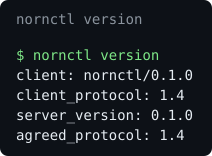
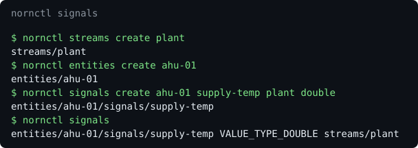
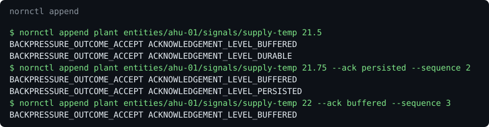
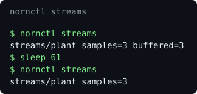
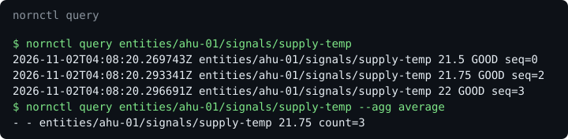

<!--
SPDX-FileCopyrightText: 2026 Srikanth K
SPDX-License-Identifier: AGPL-3.0-or-later
-->

# How Norn works

The ideas behind Norn, one at a time, each with a link to the guide or reference
that has the detail. The screenshots come from a real daemon
([`tools/screenshots/capture.sh`](../../tools/screenshots/capture.sh)). Diagrams of
the write path, the read path and the storage hierarchy are in
[architecture](../reference/architecture.md#the-system-at-a-glance).

## One API, over local IPC

Everything goes through the public gRPC API, and `nornctl` has no private door.
Protobuf under [`protobuf/`](../../protobuf) is the source of truth, and clients
negotiate a protocol version: this build speaks 1.8 (`norn_protocol::PROTOCOL_VERSION`).
Every collection has the AIP standard methods; entities and signals also have
`BatchCreateEntities` and `BatchCreateSignals`, up to 1,000 a call, all or nothing,
with one durable commit per batch. A batch is safe to repeat: what already exists is
returned as stored, so an adapter sends its whole catalogue at every start. That is
what lets a device adapter with tens of thousands of signals provision itself
quickly ([provisioning](../performance.md#provisioning)).



More: [protocol](../reference/protocol.md), [IPC](../reference/ipc.md).

## Entities, signals and streams

An entity is a thing, such as a sensor or a device; a signal is something measurable
about it, such as a temperature; and a stream is the sequence its samples go into.
Domain meaning lives in opaque metadata.



More: [getting started](getting-started.md#create-a-stream-an-entity-and-a-signal).

## Appends say how far they got

Every batch hears an outcome (`ACCEPT`, `BUFFER`, `THROTTLE`, `REJECT`) and then the
level it reached (`BUFFERED`, `PERSISTED`, `DURABLE`). Memory is budgeted per
subsystem; when a budget runs out clients are slowed or refused, and telemetry is
never dropped silently.



More: [ingesting data](ingesting-data.md).

## Stored in compressed, checksummed chunks

Samples are journalled, then encoded per signal into chunks (delta-of-delta
timestamps, Gorilla floats, dictionaries and more, with pure-Rust zstd at levels 3
to 6). Chunks sit in sealed segment files, and a sparse temporal index finds them
without opening a segment.



More: [storage](../reference/storage.md).

## Queries see everything acknowledged

A query merges chunks with what is still in memory, so a sample is visible as soon as
it is acknowledged, exactly once across the moment it reaches a chunk. Ranges, filters
on value and quality, and `LATEST`, `FIRST`, `LAST`, `COUNT`, `MIN`, `MAX`, `AVERAGE`,
`SUM` and `RATE` over fixed windows stream in bounded memory, and resume from a token.
A damaged chunk is an error, never a gap.



More: [querying](querying.md), [query](../reference/query.md).

## History, at any instant and played back

`nornctl state` shows what every signal held at an instant, straight from the index:
no checkpoints, since measurement showed they would be slower. A replay session plays a
stretch of history on a virtual clock you pause, seek, step and speed up, emitting the
same events in the same order every time; a seek first tells you the state there. Live
data arrives through the same subscription and event format.

More: [replay and state](replay.md), [replay](../reference/replay.md).

## AI agents read history through MCP

The `norn` daemon serves MCP beside gRPC when asked: `norn --mcp stdio` for a client
that launches it, or a Unix socket, named pipe or loopback-only HTTP for a daemon that
runs on its own (`[mcp] enabled` in the configuration file). The tools are generated
from the schema's `(mcp.v1.tool)` annotations, and only the 17 read-only methods are
served: catalogue reads, `BrowseSamples`, `FindEvents`, `ComputeStats`,
`ComparePeriods`, `ComputeState` and step-by-step replay through
`DriveReplaySession`. Writes, the batch creates included, are annotated
`read_only: false` and have no tool. Each call passes the same validation and limits
as gRPC, and a failure is a result carrying a stable reason.

```json
{
  "mcpServers": {
    "norn": { "command": "/path/to/norn", "args": ["--mcp", "stdio"] }
  }
}
```

MCP over loopback HTTP has no authentication: once enabled, every local user can
call it. Prefer stdio, a Unix socket or a named pipe
([MCP](../reference/mcp.md#running-it)).

More: [AI agents](ai-agents.md), [MCP](../reference/mcp.md).
