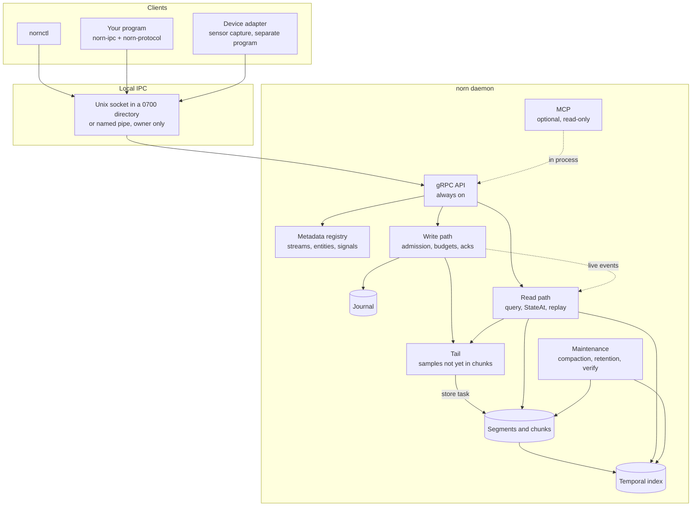
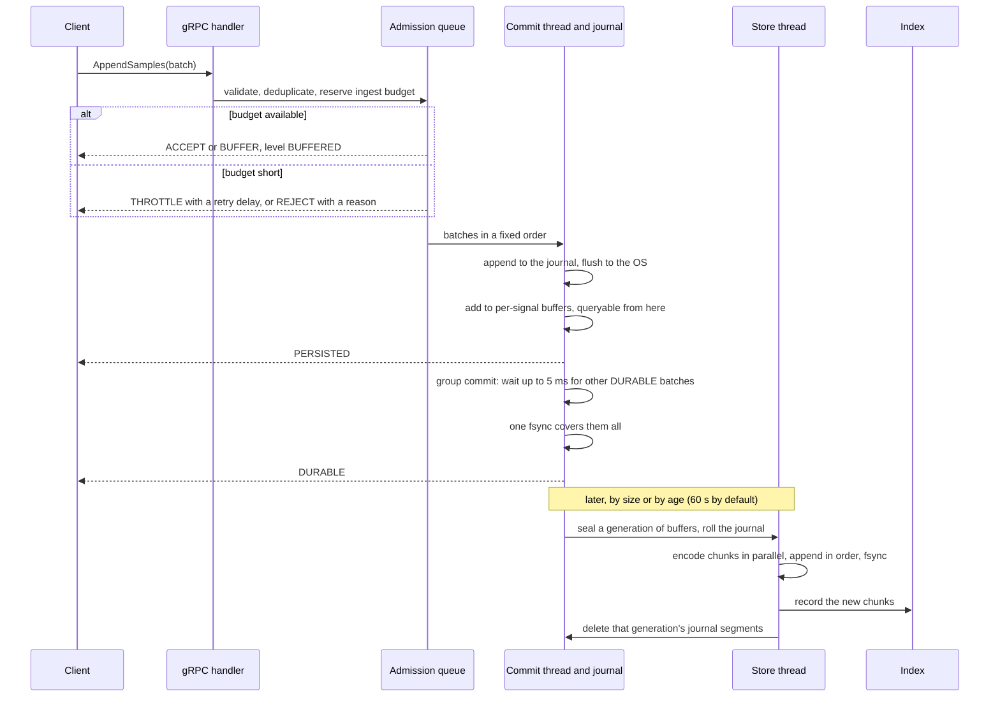
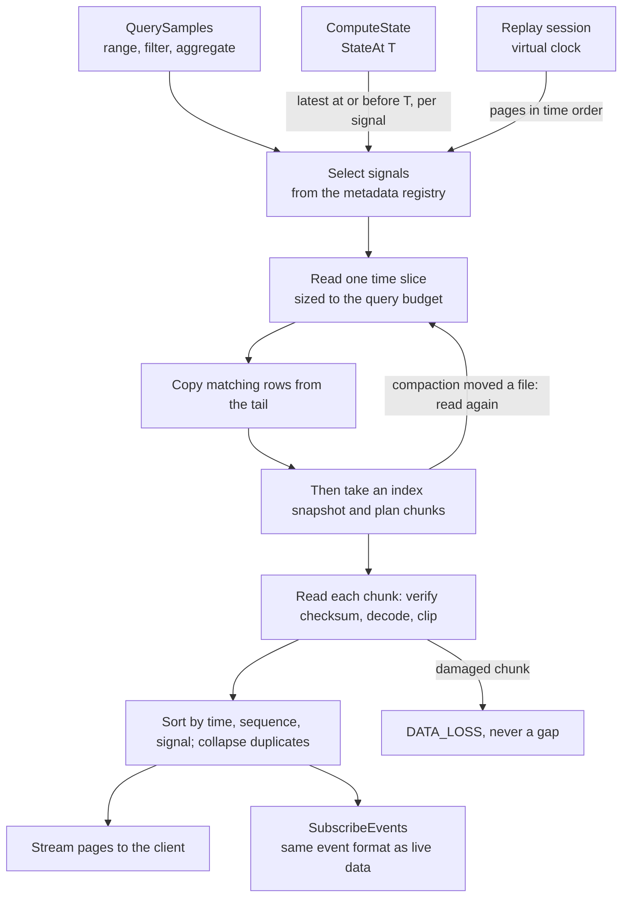
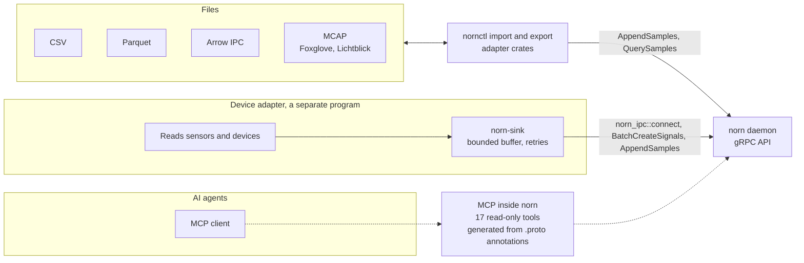
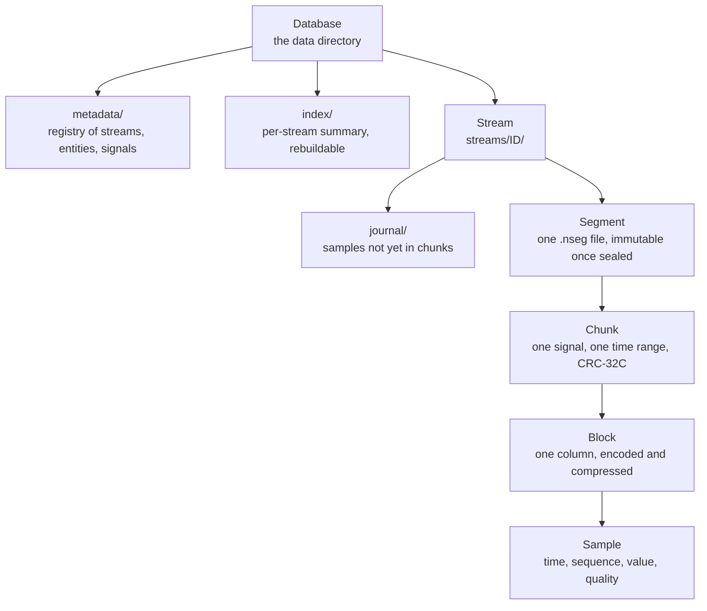

<!--
SPDX-FileCopyrightText: 2026 Srikanth K
SPDX-License-Identifier: AGPL-3.0-or-later
-->

# Architecture

What exists is marked **(exists)**; everything else is the design target from
[spec.md](../project/spec.md) and does not exist yet.

## The system at a glance

How the pieces described below fit together, from a client's call down to the files.

### The whole system



The daemon is one process. Its runtime owns the IPC server, the health mirror and the
maintenance worker. `Runtime::new` spawns nothing; `run` owns every task and returns
only when all have stopped. Details: [process model](#process-model-exists-stage-4).

### Servers: always on and optional

- **gRPC**: Always on. It cannot be disabled. It is the only API. `nornctl`, the adapters and every client use it; while the daemon runs, nothing reaches storage another way. The offline `nornctl restore` and `migrate` are the one exception ([below](#layers-and-the-dependency-table)).
- **MCP**: Optional and off by default. Served inside `norn` with `norn --mcp TRANSPORT` or `[mcp] enabled = true`, over stdio, a local socket or pipe, or loopback HTTP. No separate MCP executable is needed.
- **Shared-memory data plane**: Optional and off by default, from 1.0.0-rc.1 (protocol 1.7). Unix sockets only; the socket stays the control plane. See [Shared memory](shared-memory.md).
- **InfluxDB**: Not used. Norn has no InfluxDB dependency.

### The write path



Each batch hears two answers: its admission, then the level it asked for. A failed
`fsync` poisons the journal writer, every waiting batch gets an error, and the next
start runs recovery. Details: [ingesting data](../guides/ingesting-data.md),
[storage](storage.md).

### The read path



Reading the tail before taking the index snapshot means a sample acknowledged at
`PERSISTED` is always in one or the other, so a query sees it exactly once. Details:
[query](query.md), [replay](replay.md).

### Adapters and MCP



Every adapter is a client of the public gRPC API and nothing else. Device-protocol
adapters live outside this repository and use only Norn's public client crates
(`norn-ipc`, `norn-protocol`); a device's details become annotations that Norn stores
and never interprets. Formats and the adapter contract:
[adapters](adapters.md).

### Storage hierarchy



A segment is append-only while open and immutable once sealed. A chunk is encoded,
compressed and checksummed independently of every other chunk, so damage is found
and reported per chunk. File formats: [storage](storage.md).

## The domain-independence rule

The core knows Entity, Signal, Stream, Sample, Value, Timestamp, Sequence,
Quality and Metadata. It never knows a device protocol, a device type or an
industry (SPEC §4). Domain facts travel as strings in a
descriptor's `Metadata` map, put there by an adapter and never interpreted by
the engine: a sensor's analog reading becomes an entity, a signal of kind `F64`,
and metadata such as `protocol=...`, `object_type=...`. Quality is
a generic closed set (good/uncertain/bad plus a substatus such as
`CommunicationFailure`), onto which each adapter maps its protocol's flags.

## Layers and the dependency table

Dependencies point inward only. The table below mirrors `LAYERS` in
`xtask/src/arch.rs`, which is the authority and is enforced by `xtask arch`:
a crate may depend (normal or build edge) only on what its row lists, and a
workspace crate without a row fails the gate. Dev-dependencies are exempt.

| Crate | May import | State |
| --- | --- | --- |
| `norn-core` | nothing | exists |
| `norn-protocol` | core | exists |
| `norn-codec` | core | exists |
| `norn-metadata` | core | exists |
| `norn-transport` | core | exists |
| `norn-ipc` | core, protocol, transport | exists |
| `norn-shared-memory` | core, transport, ipc | exists (uses ipc): the opt-in iceoryx2 data plane, [shared memory](shared-memory.md) |
| `norn-storage` | core, codec | exists |
| `norn-database` | core, storage, metadata | exists: the store version, backups, restore, migration |
| `norn-index` | core, storage | exists |
| `norn-query` | core, codec, storage, index | exists |
| `norn-state` | core, storage, index, query | exists (uses core, query) |
| `norn-replay` | core, storage, index, query, state | exists (uses core, query, state) |
| `norn-runtime` | core, codec, metadata, storage, database, index, query, state, replay | exists (uses core, codec, metadata, storage, database, index, query, state, replay) |
| `norn-server` | core, protocol, transport, ipc, shared-memory, metadata, database, runtime | exists (uses core, protocol, ipc, shared-memory, metadata, database, runtime); serves MCP |
| `norn-cli` | core, protocol, transport, ipc, shared-memory, adapter, adapter-csv, adapter-parquet, adapter-mcap, database | exists (uses protocol, ipc, shared-memory for `--shared-memory`, the adapters, and database only for the offline `restore` and `migrate`, which have no daemon to be a client of) |
| `norn-adapter` | core, protocol, transport, ipc | exists (uses protocol) |
| `norn-adapter-csv`, `-parquet`, `-mcap` | adapter, protocol | exists |
| `norn-adapter-testkit` | adapter, protocol | exists, dev-only |
| `norn-sink` | protocol, transport, ipc, shared-memory | exists (uses protocol, transport, ipc; shared-memory behind its opt-in feature): a live adapter's delivery into Norn, [writing a device adapter](../guides/device-adapter.md) |
| `xtask` | nothing | exists |

Clients (CLI, adapters, `norn-sink`) reach Norn only through the protocol, and so does MCP: it runs
inside the daemon but calls the gRPC services through the in-process loopback, never
the runtime, never the
storage API (SPEC §47), which is why their rows stop at `ipc`.

**The one exception, on purpose: offline `restore` and `migrate`.** `norn-cli` imports
`norn-database` so that `nornctl restore` and `nornctl migrate` can work on a data
directory with no daemon running: there is no daemon for them to be a client of, and
the daemon refuses to start on a store mid-restore or mid-migration. They take the
database's lock, so they cannot run beside a daemon on the same directory. Every other
`nornctl` command, `backup` included, goes through the gRPC API. `xtask arch` allows
this edge in `norn-cli`'s row only. The adapters are
clients too: the contract speaks the protocol, and each format knows only the
contract. The server imports none of them, so `ExportStream` stays unimplemented
([adapters.md](adapters.md#exportstream-stays-unimplemented)).

## No C

`xtask deps` walks every workspace crate's normal dependency graph and fails
on any package with a `links` key or a `cc`, `cmake`, `pkg-config`, `vcpkg`
or `bindgen` build-dependency. The allow-list (`ALLOW_C`) is empty.

One exception, `xtask/src/runtime_rs.rs`: `norn-server` serves through runtime-rs's
`tpp-grpc` and `tpp-agents`, which record spans through OpenTelemetry. Norn builds
`tpp-grpc` without its `tls` feature, so `ring` is not in the graph; should a runtime
upgrade bring it back, `ring` (C) is excused only where it is reached through the runtime
(for `norn-server`) or the shared `rustls` crates its features select, and only while
the runtime is in the graph; OpenTelemetry and the runtime crates only beneath
`norn-server`. The engine (core, codec, storage, index, query, state, replay, runtime,
metadata) must reach none of it, not even rustls; `xtask/tests/runtime_gates.rs`
proves each rule bites and checks this repository. Norn configures no TLS, and
building `norn` needs no C compiler.

A second exception arrives with shared memory in 1.0.0-rc.1, `xtask/src/iceoryx2.rs`: two of
iceoryx2's platform crates name `cc` and `bindgen` as build-dependencies that run only
on a QNX build host. Exactly those helpers, of exactly those crates, are excused beneath
`norn-shared-memory`, `norn-server` and `norn-cli`, and any other crate that reaches
iceoryx2 fails ([shared memory](shared-memory.md#dependencies-and-gates)).

The graph is the one Cargo resolves for the targets Norn builds (`deps::PLATFORMS`:
the release matrix and CI's cross-compiles, Windows included), not for every platform a
dependency's manifest mentions. A dependency only Haiku or wasm32 would compile, such as
`iana-time-zone-haiku` under `chrono` (reached by the adapters through `arrow`), is
linked by no build of Norn. A test fails if a target that ships is missing from the list.

## The core (exists)

`norn-core` has no dependencies and performs no I/O, reads no clock and
spawns nothing (`xtask purity`). Time is always handed in, which is what will
let replay run on a virtual clock (SPEC §28). Every bounded quantity is a
field of `Config` (memory budgets per subsystem, count limits) or
`MetadataLimits`, validated by a builder; `Config::default()` is valid and
documented. Values carry a stable one-byte tag, so stored data written today
decodes identically forever and newer data is refused, not misread.

## Process model (exists: stage 4)

`norn` is a standalone local daemon: a foreground process, with no network
server, supervised by whatever runs it. Applications connect over gRPC on
local IPC (Unix sockets; named pipes on Windows). The CLI, `nornctl`, is an
ordinary client of the same public API (SPEC §33).

```text
main (crates/server/src/main.rs)
 ├─ parse_args: built-in defaults < TOML file < flags
 ├─ logging::init: synchronous stderr, each record size-capped
 └─ Daemon::bind: claims the endpoint, builds every service, spawns nothing
     └─ Daemon::run → Runtime::run
         ├─ task "ipc":         norn-ipc Server::serve(router) until cancelled
         ├─ task "health":      mirrors Health into grpc.health.v1
         └─ task "maintenance": compaction, retention, verification, one job at a time
```

The runtime (`norn-runtime`) owns the lifecycle and knows nothing of networks:
serving gRPC is just one of its tasks.

- **Constructing has no effect.** `Runtime::new` validates and spawns nothing.
  `Daemon::bind` additionally claims the endpoint, so a second daemon fails at
  start; dropping a bound daemon releases it.
- **`run` owns everything it spawns.** Tasks live in a `JoinSet` local to `run`,
  which returns only once all have ended. Dropping the `run` future aborts them.
- **Health** moves `starting → serving → draining → stopped`. The health service
  says `SERVING` only in `serving`. `Serving` means the tasks are spawned;
  because the endpoint was bound first, a client arriving in that instant
  queues in the backlog rather than fail, though it may read `NOT_SERVING` once.
- **Shutdown.** SIGINT or SIGTERM (Ctrl-C or Ctrl-Break on Windows) cancels the
  token `run` holds. Health becomes `draining`, and every task's token is
  cancelled. The IPC task releases the endpoint, sends GOAWAY, lets in-flight
  calls finish for the drain bound (default 10 s), and aborts what remains. The
  runtime gives its tasks that bound plus 5 s, then aborts any still running.
  Budgets close, health becomes `stopped`, the socket is gone, and `norn` exits
  0. A later signal is ignored: the bounds above, not a second Ctrl-C, end it.
- **A task returning an error is fatal**: the others drain as above and `norn`
  exits 1. A refused command line or configuration exits 2, before anything binds.
- **Time is injected** through the `Clock` trait. Every runtime timeout and
  budget wait runs on `FakeClock` in tests. (norn-ipc's own drain bound still
  uses tokio's timer.)

### Memory budgets

`Budgets` holds one `Budget` per field of `Config::memory()`. Code reserves
before it holds bytes and gets a `Reservation`, which returns them on drop.
`try_reserve` refuses at once with a typed `BudgetError`; `reserve` waits up to
a caller-given bound. Waiters are not FIFO: a large reservation can wait out its
bound under a steady stream of small ones. The write path draws on `ingest_bytes`
([storage.md, "Write path"](storage.md#write-path)); the IPC layer draws on `ipc_bytes`;
queries draw on `query_bytes` ([query.md](query.md#bounded-memory)); compaction draws on `chunk_cache_bytes`.

`ipc_bytes` is split in two, since hyper owns one half's buffers and the daemon
accounts for the other:

- **Flow-control windows.** Each connection's HTTP/2 window is `ipc_bytes / 2 /
  max_clients` (floor 65,535), which bounds unread inbound data. At bind the
  daemon reserves this for all clients, permanently. Each of a connection's 16
  calls gets a seventeenth of it. A call waiting for decode budget stops reading,
  and its unread bytes stay charged to the connection, so a stream window any
  larger would let waiting calls starve the call that holds the budget, which
  could then never finish its message: a deadlock multiplexed clients really hit.
- **Decoding.** tonic buffers a whole message and prost then expands it, so the
  bytes one call can pin are its message times the decode's expansion. A layer
  in front of every service (`metered.rs`) reads each gRPC frame header as it
  arrives and, before releasing those bytes to tonic, reserves the message's
  worst-case decoded size from what is left of the budget. It waits for room up
  to 30 s, and meanwhile the stalled body stops consuming the flow-control window,
  so the client feels it as backpressure. One message is released at a time, and
  its reservation lasts until the handler asks for the next message, or for a
  unary call until it answers; by then a batch is in the ingest budget. A client
  that stalls midway through a message keeps its reservation: others wait, and
  fail with `RESOURCE_EXHAUSTED` after 30 s. So
  decode memory is bounded by the budget at any number of calls, not 64 clients ×
  64 calls × 4 MiB. A call holds one reservation at a time, taken whole, because a call waiting
  for a second while holding a first can deadlock with its peers. `AppendSamples`
  reserves `2 × length + min(length / 2, max_batch_samples) × size_of::<Sample>()`,
  capped at the decoding half, then counts samples from the raw bytes *before*
  prost allocates and shrinks to `2 × length + samples × size_of::<Sample>()`
  (tonic's buffer, then prost's strings). A batch over `max_batch_samples`, or too
  costly for that cap, has its samples stripped, so the handler rejects it by id
  with `BATCH_TOO_LARGE`. At the default budget the cap cannot be reached by a
  batch within the published limits. Every other method is limited to `max_message_bytes`, 256 KiB, and
  costs 32 × length, the expansion of a map entry.

`ipc_bytes` does not cover what hyper holds for responses, connection state, or
code and stacks; the headroom under `total_bytes` is for those.

Metadata, storage, the temporal index, the write path and queries are behind the
IPC layer: `norn-metadata` holds the durable registry of resources, `norn-index` the
index, `norn-runtime`'s `ingest` module the write path, `norn-query` the read path
([query.md](query.md)). The server may not import `norn-query`, so it uses
`norn_runtime::query`. `norn-state` answers `StateAt(T)` over the query engine,
reached the same way through `norn_runtime::state` ([query.md](query.md#state-at-an-instant)).
`norn-replay` holds a replay's virtual clock and state machine; the runtime drives
each session on its clock and tasks and fans live samples out
([replay.md](replay.md)). `norn-runtime`'s `maintenance` module keeps a database
healthy over a long life ([storage.md](storage.md#maintenance)). `norn-shared-memory`
implements `norn-ipc`'s `DataPlane` and `Attach` seams over iceoryx2, opt-in and
Unix only ([shared memory](shared-memory.md)). Platform code sits behind per-platform modules
(`crates/server/src/signal/`, `crates/transport/src/platform/`), never scattered
`cfg`.
